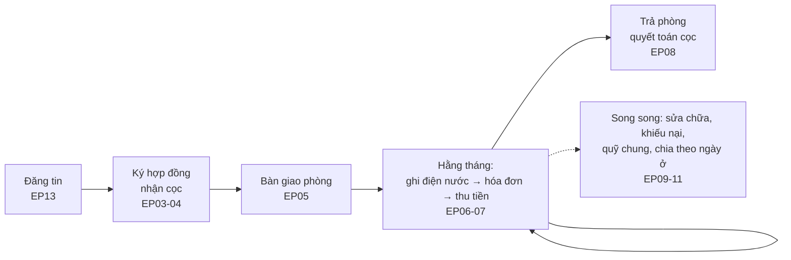
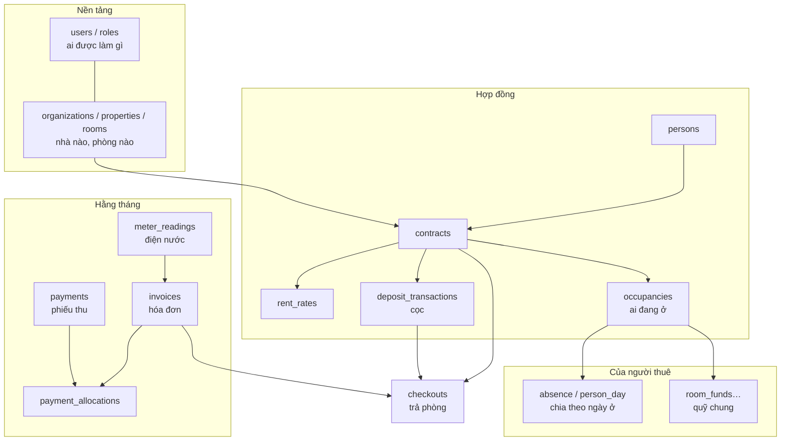

# Hiểu database BoardingHub qua một câu chuyện

> Tài liệu này giải thích bằng lời thường, không cần biết SQL vẫn đọc được.
> Bản kỹ thuật đầy đủ (ràng buộc, trigger, mã BR/AC) nằm ở `phan_tich_luong_database.md`.

---

## Phần 1. Bức tranh tổng thể trong 1 phút

Hãy tưởng tượng database như **bộ hồ sơ giấy của một chủ trọ**, được chia vào các ngăn tủ:

| Ngăn tủ | Chứa gì | Nhóm bảng trên sơ đồ |
|---|---|---|
| Sổ nhân sự | Ai được đăng nhập, ai được làm gì | EP01 |
| Sổ nhà | Khu trọ nào, phòng nào, bao nhiêu người ở được | EP02 |
| Tủ hợp đồng | Người thuê, hợp đồng, giá thuê, tiền cọc | EP03, EP04 |
| Biên bản bàn giao | Phòng có đồ gì, tình trạng ra sao lúc nhận và lúc trả | EP05 |
| Sổ điện nước | Đồng hồ, chỉ số hằng tháng | EP06 |
| Sổ thu tiền | Hóa đơn, phiếu thu | EP07 |
| Hồ sơ trả phòng | Quyết toán cọc khi người thuê đi | EP08 |
| Sổ sửa chữa và khiếu nại | Báo hỏng, tranh chấp | EP09 |
| Bảng chấm ngày ở | Ai ở bao nhiêu ngày để chia tiền điện nước | EP10 |
| Sổ quỹ chung của người thuê | Tiền góp chung, mua đồ chung | EP11 |
| Kho giấy tờ | Ảnh, PDF, hồ sơ tạm trú | EP12 |
| Bảng đăng tin | Tin cho thuê, lịch hẹn xem phòng | EP13 |
| Sổ chi và việc cần nhắc | Chi phí sửa chữa, lời nhắc | EP14 |
| Camera an ninh và két sắt | Nhật ký thao tác, bản sao lưu | EP15 |

Thứ tự các ngăn cũng là thứ tự công việc ngoài đời:



---

## Phần 2. Bốn nguyên tắc "vàng" — hiểu 4 điều này là hiểu 80% thiết kế

### Nguyên tắc 1: Tiền đã ghi thì không tẩy xóa

Ngoài đời, kế toán ghi sai thì **không dùng bút xóa**. Họ gạch dòng sai, ghi chú lý do, rồi viết dòng đúng bên dưới. Database làm y hệt:

- Phiếu thu ghi sai: không xóa, chuyển trạng thái **VOIDED** (đã hủy) kèm lý do, rồi tạo phiếu mới.
- Hóa đơn đã gửi cho khách: không sửa số tiền. Muốn tăng hay giảm thì lập **phiếu điều chỉnh** (`invoice_adjustments`).

Database có **trigger** (giống chuông báo động) tự chặn mọi lệnh xóa hoặc sửa số tiền trên các bảng tiền. Kể cả lập trình viên viết code sai cũng không phá được.

> **Vì sao?** Khi có tranh cãi kiểu "tháng trước tôi đóng rồi mà", chủ trọ mở lại được toàn bộ lịch sử, không ai chối được.

### Nguyên tắc 2: Không lưu "số dư", luôn cộng từ lịch sử

Database **không có ô nào ghi "anh Nam còn nợ 400.000"**. Thay vào đó nó lưu từng sự kiện:

- Hóa đơn tháng 11: 1.000.000
- Phiếu thu ngày 5: 600.000

Khi cần biết còn nợ bao nhiêu, nó tính 1.000.000 − 600.000 = 400.000.

> **Vì sao?** Nếu lưu sẵn số dư, chỉ cần một lần cập nhật quên là số dư lệch với lịch sử mãi mãi. Tính lại từ lịch sử thì luôn đúng. Giống sổ ngân hàng: số dư chỉ là tổng các dòng giao dịch.

### Nguyên tắc 3: Thay đổi thì tạo phiên bản mới, giữ bản cũ

Gia hạn hợp đồng, đổi giá thuê, sửa biên bản, sửa hồ sơ tạm trú: tất cả đều **tạo bản mới, bản cũ vẫn còn**.

Ví dụ giá thuê: bảng `rent_rates` có hai dòng

| Từ ngày | Đến ngày | Giá |
|---|---|---|
| 01/01/2026 | 14/11/2026 | 3.000.000 |
| 15/11/2026 | (chưa hết) | 3.200.000 |

Hóa đơn tháng 11 sẽ tự chia làm hai đoạn: 14 ngày giá cũ và 16 ngày giá mới.

### Nguyên tắc 4: Bấm hai lần cũng chỉ tính một lần

Mạng chậm, người dùng sốt ruột bấm "Xác nhận thu tiền" hai lần. Nếu không cẩn thận thì tiền bị cộng gấp đôi.

Mỗi thao tác quan trọng mang một **mã chống lặp** (`idempotency_key`). Database không cho phép hai dòng trùng mã, nên lần bấm thứ hai bị từ chối.

> Áp dụng cho: phiếu thu, lập hóa đơn, góp quỹ, bù trừ quỹ, gửi thông báo, quyết toán.

---

## Phần 3. Câu chuyện phòng 101

**Nhân vật:**
- **Cô Lan**: chủ trọ, có khu trọ "Nhà Xanh".
- **Anh Minh**: nhân viên quản lý của cô Lan.
- **Nam, Hùng, Tú**: ba bạn sinh viên thuê chung phòng 101. Nam đứng tên hợp đồng.

---

### Chương 1. Cô Lan bắt đầu dùng hệ thống

| Việc ngoài đời | Dữ liệu ghi vào |
|---|---|
| Cô Lan đăng ký tài khoản | `users` (tài khoản), `organizations` (doanh nghiệp "Nhà trọ cô Lan") |
| Hệ thống ghi cô Lan là chủ | `user_role_assignments`: cô Lan, vai trò OWNER, toàn tổ chức |
| Tạo khu "Nhà Xanh" và phòng 101 (tối đa 3 người) | `properties`, `rooms` (`capacity` = 3, trạng thái VACANT = trống) |
| Khai báo phòng có 1 giường, 1 tủ, 1 điều hòa | `room_assets` |
| Khai báo dịch vụ: điện 3.500đ/số, nước 15.000đ/khối, wifi 100.000đ/phòng | `services` (loại dịch vụ), `service_prices` (giá, có ngày hiệu lực) |
| Lắp đồng hồ điện và đồng hồ nước cho phòng 101 | `meters` |
| Thuê anh Minh, chỉ cho quản lý khu Nhà Xanh | `users` + `user_role_assignments`: STAFF, phạm vi khu Nhà Xanh |

**Điểm hay:** `user_role_assignments` có **phạm vi**. Anh Minh chỉ thấy khu Nhà Xanh; nếu cô Lan có khu thứ hai, anh Minh không thấy. Và vì mỗi dòng dữ liệu đều có `organization_id`, chủ trọ khác dùng cùng hệ thống cũng **không bao giờ** thấy dữ liệu của cô Lan.

**Quyền nhạy cảm** như thu tiền, hoàn cọc: mặc định chỉ chủ trọ có. Muốn anh Minh được thu tiền, cô Lan phải cấp riêng (`assignment_permission_grants`). Cấp hay thu hồi đều có hiệu lực ngay lập tức.

---

### Chương 2. Đăng tin và dẫn khách xem phòng

| Việc ngoài đời | Dữ liệu ghi vào |
|---|---|
| Anh Minh đăng tin "Phòng 101, 3 triệu, gần ĐH Bách Khoa" | `room_listings`: DRAFT → gửi duyệt → PUBLISHED |
| Nam thấy tin, để lại số điện thoại | `rental_inquiries` (khách không cần tài khoản) |
| Hẹn Nam 9h sáng thứ Bảy xem phòng | `viewing_appointments` |
| Nam xin dời sang Chủ nhật | `appointment_history` ghi giờ cũ, giờ mới |
| Nam xem xong | Lịch hẹn → COMPLETED |

**Điểm hay:** xem phòng xong **không tự tạo hợp đồng**. Đăng tin cũng **không đổi trạng thái phòng**. Đó là hai việc riêng: đăng tin là quảng cáo, hợp đồng là pháp lý.

---

### Chương 3. Ký hợp đồng, nhận cọc, dọn vào

Đây là chương quan trọng nhất. Đọc chậm.

**Bước 1: Ghi thông tin người thuê.** Nam, Hùng, Tú vào bảng `persons`. Chỉ bắt buộc họ tên; số CCCD không bắt buộc và được mã hóa nếu có.

> Vì sao tách `persons` khỏi `users`? Vì người thuê **có thể không có tài khoản** (ví dụ Tú không dùng app). `persons` là "con người trong hồ sơ", `users` là "tài khoản đăng nhập". Nếu Nam có tài khoản thì `persons.user_id` nối hai thứ lại.

**Bước 2: Tạo hợp đồng nháp.** Bảng `contracts` (trạng thái DRAFT), ghi:

- phòng 101, người đại diện là Nam;
- từ 01/12/2026 đến 30/11/2027;
- kỳ thu theo tháng dương lịch, hạn đóng là 5 ngày sau khi phát hành hóa đơn;
- cọc yêu cầu 3.000.000.

Đồng thời tạo bản phiên bản số 1 trong `contract_versions`. Đây là ảnh chụp điều khoản lúc ký.

**Bước 3: Giá thuê và dịch vụ.**

- `rent_rates`: 3.000.000/tháng từ 01/12/2026.
- `contract_services`: hợp đồng này dùng điện, nước, wifi.

> Vì sao giá thuê nằm ở bảng riêng, không phải một cột trong `contracts`? Vì giá thay đổi theo thời gian (Nguyên tắc 3). Một cột chỉ giữ được một giá; một bảng giữ được cả lịch sử.

**Bước 4: Ai ở phòng này.** Bảng `occupancies` (lượt cư trú), mỗi người một dòng:

| Người | Vai trò | Ngày vào |
|---|---|---|
| Nam | REPRESENTATIVE (đại diện) | 01/12 |
| Hùng | MEMBER | 01/12 |
| Tú | MEMBER | 01/12 |

> Vì sao cần bảng này, khi hợp đồng đã có người đại diện? Vì một hợp đồng có nhiều người ở, và họ có thể vào ra vào những ngày khác nhau. Ví dụ tháng 3 Tú dọn đi, tháng 4 có bạn Bình vào thay, trong khi hợp đồng vẫn của Nam. Bảng này còn là căn cứ để tính Ngày Người và quyền xem dữ liệu của người thuê.

Ứng dụng kiểm tra: số người đang ở ≤ sức chứa phòng (3). Thêm người thứ 4 sẽ bị chặn.

**Bước 5: Nhận cọc.** Nam đưa trước 2.000.000 (thiếu 1 triệu, hẹn tuần sau). Ghi vào `deposit_transactions`: loại RECEIVE, 2.000.000. Tuần sau ghi thêm một dòng RECEIVE 1.000.000.

> Vì sao cọc có bảng riêng, không ghi chung với phiếu thu tiền phòng? Vì **cọc không phải doanh thu**. Đó là tiền của người thuê, chủ trọ chỉ giữ hộ và phải trả lại khi họ đi. Nếu trộn chung, báo cáo doanh thu sẽ sai.

**Bước 6: Biên bản nhận phòng.** `handovers` (loại CHECK_IN) kèm `handover_items`: giường tốt, tủ tốt, điều hòa hơi cũ (WORN), có chụp ảnh lưu ở `stored_files` và `file_links`.

**Bước 7: Chốt chỉ số đầu.** `meter_readings` loại CHECK_IN: điện 1.000, nước 50.

**Bước 8: Bấm "Kích hoạt hợp đồng".** Một cú bấm, nhiều việc xảy ra **cùng lúc** (hoặc tất cả thành công, hoặc không có gì thay đổi):

- `contracts` → ACTIVE;
- 3 dòng `occupancies` → ACTIVE;
- `rooms` → OCCUPIED (đang có người), ghi vào `room_status_history`;
- biên bản → CONFIRMED;
- mở quỹ phòng (`room_funds`), nếu nhóm muốn dùng.

**Điểm hay:** database có khóa **"mỗi phòng chỉ một hợp đồng đang hiệu lực"**. Nếu anh Minh lỡ tạo hợp đồng thứ hai cho phòng 101 và bấm kích hoạt, database báo lỗi ngay. Không bao giờ có chuyện một phòng cho hai nhóm thuê.

---

### Chương 4. Cuối tháng 12: ghi điện nước

| Việc ngoài đời | Dữ liệu ghi vào |
|---|---|
| Hệ thống mở kỳ thu tháng 12 cho hợp đồng của Nam | `billing_periods`: 2026-12, từ 01/12 đến 31/12 |
| Anh Minh chụp ảnh đồng hồ điện | `stored_files` (ảnh), `ocr_jobs` (máy đọc ảnh) |
| Máy đọc được "1.120", độ tin cậy 95% | `ocr_jobs.suggested_value` = 1.120 |
| Anh Minh kiểm tra, đúng, bấm xác nhận | `meter_readings`: số cũ 1.000, số mới 1.120, CONFIRMED |

**Điểm hay:**

- Máy đọc ảnh **chỉ gợi ý**, người phải xác nhận. Máy đọc lỗi thì **không tự điền số 0**.
- Database chặn **số mới nhỏ hơn số cũ** (đồng hồ không chạy lùi).
- Nếu đồng hồ hỏng phải thay giữa tháng, hệ thống ghi **hai đoạn**: đồng hồ cũ 1.000 → 1.080, đồng hồ mới 0 → 20. Tổng tiêu thụ 100 số, không mất dữ liệu.

---

### Chương 5. Lập hóa đơn tháng 12

Hệ thống tự lập hóa đơn nháp `invoices` (DRAFT) với các dòng chi tiết `invoice_items`:

| Dòng | Cách tính | Tiền |
|---|---|---|
| Tiền phòng | 3.000.000 × 1 tháng | 3.000.000 |
| Điện | (1.120 − 1.000) × 3.500 | 420.000 |
| Nước | (58 − 50) × 15.000 | 120.000 |
| Wifi | 100.000 × 1 phòng | 100.000 |
| **Tổng** | | **3.640.000** |

Mỗi dòng lưu kèm **công thức đã dùng** (`calculation_snapshot`). Sau này giá điện có tăng, người xem vẫn biết tháng 12 tính theo giá nào.

Anh Minh xem lại rồi bấm **Phát hành** → hóa đơn ISSUED, hạn đóng 05/01. Kỳ tháng 12 bị khóa (LOCKED).

**Điểm hay:**

- Lỡ bấm "lập hóa đơn" hai lần: chỉ ra **một** hóa đơn. Mỗi kỳ chỉ có một hóa đơn định kỳ còn hiệu lực, và mỗi dòng có mã nguồn riêng nên không bị nhân đôi.
- Hóa đơn đã phát hành thì **khóa cứng**: không thêm, sửa hay xóa dòng được (trigger chặn). Phát hiện ghi nhầm số nước thì lập **phiếu điều chỉnh** −30.000 kèm lý do.
- "Quá hạn" **không lưu** thành cột. Cứ qua ngày 05/01 mà còn nợ thì tự hiểu là quá hạn (Nguyên tắc 2).

---

### Chương 6. Thu tiền

**Lần 1:** Nam chuyển khoản 2.000.000.

- `payments`: phiếu thu 2.000.000, chuyển khoản, có mã chống lặp.
- `payment_allocations`: gán 2.000.000 vào hóa đơn tháng 12.
- Còn nợ: 3.640.000 − 2.000.000 = 1.640.000 → hóa đơn PARTIALLY_PAID.

**Mạng lag, app gửi lại lệnh lần nữa:** mã chống lặp trùng, database từ chối. Tiền không bị cộng hai lần.

**Lần 2:** Nam chuyển 2.000.000 (dư 360.000).

- Phiếu thu mới 2.000.000, gán 1.640.000 vào hóa đơn → PAID.
- **360.000 dư nằm yên trên phiếu thu đó**, không tự chuyển vào cọc hay quỹ. Tháng sau có thể gán sang hóa đơn tháng 1, hoặc trả lại cho Nam (`overpayment_refunds`).

> Vì sao tách "phiếu thu" và "phân bổ"? Ngoài đời, một lần chuyển khoản có thể trả cho nhiều hóa đơn, và một hóa đơn có thể được trả bằng nhiều lần chuyển. Tách ra mới ghi được quan hệ nhiều–nhiều này.

**Anh Minh ghi nhầm 2.000.000 thành 200.000:** phiếu sai → VOIDED (kèm lý do), phân bổ của nó → REVERSED, rồi tạo phiếu đúng có ghi "thay cho phiếu số X". Lịch sử còn nguyên.

---

### Chương 7. Ba bạn đi về quê không đều nhau: Ngày Người

Tháng 1, tiền điện nước của phòng là 960.000. Nhưng:

- Nam ở đủ 31 ngày.
- Hùng về quê 10 ngày, có xin vắng và được duyệt.
- Tú về quê 15 ngày nhưng **quên xin**.

| Việc | Dữ liệu |
|---|---|
| Hùng gửi đơn vắng 10 ngày → được duyệt | `absence_requests`: APPROVED |
| Cuối kỳ, hệ thống chốt | `allocation_batches`: tổng cần chia 960.000 |
| Tính từng người | `person_day_allocations` |

| Người | Ngày trong kỳ | Ngày vắng được duyệt | Ngày Người | Phần chịu |
|---|---|---|---|---|
| Nam | 31 | 0 | 31 | 960.000 × 31/83 ≈ 358.554 |
| Hùng | 31 | 10 | 21 | ≈ 242.892 |
| Tú | 31 | 0 (không xin nên không trừ) | 31 | ≈ 358.554 |
| **Tổng** | | | **83** | **960.000** (làm tròn, phần dư 1đ chia theo quy tắc) |

**Điểm hay:**

- Chỉ đơn **được duyệt** mới bị trừ.
- Hai đơn vắng chồng ngày nhau (ví dụ ngày 5–10 và 8–12) được gộp thành 8 ngày, không trừ trùng.
- Tổng sau khi chia **luôn bằng đúng** số tiền gốc.
- Nếu cả phòng đi vắng hết (tổng Ngày Người = 0), database **không cho chốt**: phải có người quyết định cách xử lý.
- Chia Ngày Người **không đổi tổng hóa đơn của chủ trọ**. Nó chỉ cho ba bạn biết mỗi người góp bao nhiêu.
- Lý do vắng là riêng tư: Nam không xem được lý do của Hùng.

---

### Chương 8. Quỹ chung và mua nồi cơm điện

Ba bạn lập quỹ chung, mỗi người góp 200.000/tháng.

**Góp quỹ bình thường:**

- Đầu tháng, hệ thống tạo **nghĩa vụ** cho mỗi người: `fund_obligations` (Nam phải góp 200.000 tháng 2).
- Hùng góp: `fund_transactions` loại CONTRIBUTION 200.000 → nghĩa vụ của Hùng xong.

**Nam ứng tiền túi mua nồi cơm điện 120.000:**

1. Nam tạo **đề nghị mua chung** kèm ảnh hóa đơn: `shared_purchases` + `shared_purchase_revisions` (số tiền 120.000).
2. Cần **ít nhất 2 người khác** xác nhận: `purchase_approvals`.
   - Nam tự bấm duyệt: database chặn (người đề nghị không tự duyệt).
   - Hùng bấm duyệt 2 lần: chỉ tính 1 lần.
   - Tú duyệt: đủ 2 người → APPROVED.
   - Nếu Nam sửa số tiền thành 150.000, các lượt duyệt cũ **mất hiệu lực**, phải duyệt lại.
3. Hệ thống **giữ chỗ** 120.000 trong quỹ (`fund_reservations`) và ghi Nam có **quyền được hoàn** 120.000 (`fund_refund_entitlements`).
4. Tháng sau, Nam không phải đóng đủ 200.000. Hệ thống **bù trừ** (`fund_offsets`): trừ 120.000 vào nghĩa vụ của Nam, Nam chỉ góp thêm 80.000.

**Vì sao không đưa tiền mặt từ quỹ cho Nam?** Vì bù trừ đơn giản hơn: không ai phải cầm tiền mặt. Bù trừ **không tạo giao dịch tiền mặt** trong sổ quỹ, vì thực tế không có đồng nào đi ra.

**Hai đề nghị cùng xin giữ tiền một lúc:** quỹ còn 150.000, hai đề nghị mỗi cái 100.000 cùng bấm. Ứng dụng **khóa quỹ** khi xử lý: đề nghị đầu giữ được, đề nghị sau thấy không đủ thì chuyển sang "chờ tiền". **Quỹ không bao giờ âm.**

**Quan trọng:** quỹ là tiền của người thuê. Chủ trọ **không** được dùng nó, nó **không** trừ vào hóa đơn tiền phòng, và **không** nằm trong báo cáo doanh thu của chủ trọ.

---

### Chương 9. Điều hòa hỏng và một vụ khiếu nại

**Điều hòa hỏng:**

| Việc | Dữ liệu |
|---|---|
| Nam báo hỏng, kèm ảnh | `maintenance_requests` (NEW) |
| Anh Minh nhận việc → đang sửa → xong | Mỗi lần đổi trạng thái ghi `maintenance_status_history` (ai, lúc nào, ghi chú gì) |
| Thợ sửa hết 500.000 | `operating_expenses` (chi phí của chủ trọ, gắn với yêu cầu sửa) |
| Nếu do người thuê làm hỏng | Thêm dòng "thu lại" vào hóa đơn |

**Khiếu nại:** Hùng cho rằng tiền nước tháng 1 tính sai.

- `disputes` (OPEN) + `dispute_parties` (Hùng mở, cô Lan trả lời, anh Minh xử lý). Chỉ những người này mới đọc được.
- Trao đổi qua lại: `dispute_events`.
- Kết luận đúng là sai 30.000 → lập phiếu điều chỉnh −30.000 gắn với khiếu nại.

**Điểm hay:** mở khiếu nại **không tự xóa nợ**. Nợ chỉ giảm khi có phiếu điều chỉnh được duyệt.

---

### Chương 10. Hồ sơ tạm trú

| Việc | Dữ liệu |
|---|---|
| Chọn mẫu đơn tạm trú đang dùng | `residence_form_templates` |
| Tú điền thông tin | `residence_documents` + `residence_document_versions` (bản 1) |
| Anh Minh kiểm tra, thấy thiếu ngày sinh → yêu cầu sửa | bản 1: NEEDS_REVISION, kèm nhận xét |
| Tú sửa | bản 2 |
| Anh Minh thấy đủ | VERIFIED, xuất PDF gắn đúng bản 2 |

**Điểm hay:**

- "VERIFIED" chỉ có nghĩa là **hệ thống đã kiểm tra đủ thông tin**, **không phải** đã đăng ký xong với công an phường. Giao diện phải ghi rõ để tránh hiểu lầm.
- Mọi lần mở hay tải file PDF đều ghi lại (`file_access_logs`), kể cả lần bị từ chối. Biết đường dẫn file cũng không tải được nếu không có quyền.

---

### Chương 11. Nam trả phòng

Tháng 11/2027 hợp đồng hết hạn, cả nhóm dọn đi.

**Bước 1:** tạo hồ sơ trả phòng `checkouts` (DRAFT).

**Bước 2:** biên bản trả phòng (`handovers` loại CHECK_OUT), so với lúc nhận: **tủ bị gãy cánh**.

**Bước 3:** chốt chỉ số điện nước cuối, lập hóa đơn trả phòng (tiền phòng lẻ ngày + điện nước đến ngày đi).

**Bước 4:** đề xuất **khấu trừ** sửa tủ 300.000 (`checkout_deductions`), kèm ảnh. Cô Lan duyệt → APPROVED. Khấu trừ chưa duyệt thì không được trừ cọc.

**Bước 5:** hệ thống tính quyết toán. Giả sử Nam còn nợ hóa đơn cuối 800.000:

```
Nợ chưa trả                       800.000
+ Khấu trừ sửa tủ                 300.000
= Tổng phải trả                 1.100.000

Cọc đang giữ                    3.000.000
Dùng cọc để trừ                 1.100.000
Hoàn lại cho Nam                1.900.000
Nam phải trả thêm                       0
```

Database có **4 công thức kiểm tra** ngay trên bảng `checkouts`. Số liệu nào lệch công thức (ví dụ hoàn sai một đồng) là database **từ chối lưu**.

**Bước 6:** cô Lan bấm **Xác nhận**. Cùng lúc:

- ghi cọc: dùng trừ nợ 1.100.000 và hoàn 1.900.000 (`deposit_transactions`);
- hóa đơn cuối được thanh toán bằng tiền cọc;
- 3 lượt cư trú → ENDED; hợp đồng → TERMINATED; phòng 101 → VACANT (sẵn sàng cho thuê lại);
- quyền hoàn quỹ còn lại của ai (nếu có) → tạm giữ, chờ xử lý.

**Điểm hay:**

- Mỗi hợp đồng chỉ có **một** quyết toán còn hiệu lực. Bấm xác nhận hai lần **không hoàn cọc hai lần**.
- Quyết toán đã xác nhận thì **khóa vĩnh viễn**, không ai sửa số được.
- Nếu tủ hỏng đã được tính vào hóa đơn cuối rồi, hệ thống đánh dấu và **không trừ lần hai**.

---

### Chương 12. Những thứ chạy ngầm phía sau

**Nhắc việc** (`reminders`, `notifications`): hệ thống tự kiểm tra hằng ngày:

- phòng nào chưa ghi điện nước;
- hóa đơn nào quá hạn;
- hợp đồng nào sắp hết hạn;
- bản sao lưu nào bị lỗi.

Trước khi gửi nhắc, nó **kiểm tra lại** (Nam vừa trả đủ thì không nhắc nữa). Chạy lại nhiều lần cũng không gửi trùng.

**Nhật ký** (`audit_logs`): ghi ai làm gì, lúc nào, trước và sau ra sao. Bảng này **chỉ được thêm**, không ai sửa hay xóa được, kể cả quản trị viên (trigger chặn). Giống camera an ninh không có nút xóa.

**Sao lưu** (`backup_jobs`, `restore_tests`): sao lưu mỗi ngày. Định kỳ thử **khôi phục thật** vào một máy riêng, rồi đối chiếu số dư, số hợp đồng, file PDF. Chỉ khi khớp mới tính là đạt; có file sao lưu thôi chưa đủ.

---

## Phần 4. Tóm tắt một trang



| Câu hỏi | Bảng trả lời |
|---|---|
| Phòng 101 đang ai thuê? | `contracts` (ACTIVE) + `occupancies` (ACTIVE) |
| Giá thuê tháng này bao nhiêu? | `rent_rates` có ngày hiệu lực bao trùm tháng này |
| Tháng này dùng bao nhiêu điện? | `meter_readings` CONFIRMED của kỳ |
| Nam còn nợ bao nhiêu? | Tổng `invoices` (+ điều chỉnh) − tổng `payment_allocations` |
| Cọc còn bao nhiêu? | Nhận − đã dùng − đã hoàn trong `deposit_transactions` |
| Quỹ còn bao nhiêu? | Góp − chi trong `fund_transactions`, trừ phần đang giữ chỗ |
| Ai đã sửa hóa đơn này? | `audit_logs` |

---

## Phần 5. Câu hỏi thường gặp khi bảo vệ đồ án

**Hỏi: Sao nhiều bảng thế (72 bảng)?**
Đáp: Vì phạm vi BA rộng (15 epic), và nhóm chọn **đúng hơn là ít bảng**. Mỗi khái niệm nghiệp vụ có một chỗ riêng. Ví dụ cọc, tiền phòng và quỹ là ba loại tiền khác chủ sở hữu, nên ba bảng riêng để không bao giờ trộn. Nhiều bảng chỉ là bảng lịch sử nhỏ (`*_history`, `*_versions`).

**Hỏi: Sao không lưu cột "số dư" cho nhanh?**
Đáp: Số dư lưu sẵn có thể lệch với lịch sử nếu một lần cập nhật bị lỗi. Tính từ giao dịch thì luôn đúng và kiểm toán được. Với quy mô nhà trọ (vài trăm phòng), phép cộng này rất nhanh. Nếu cần tối ưu sau này, có thể thêm bảng tổng hợp mà không đổi thiết kế gốc.

**Hỏi: Hai người cùng thu tiền một hóa đơn một lúc thì sao?**
Đáp: Ứng dụng khóa dòng hóa đơn khi phân bổ (`SELECT … FOR UPDATE`). Người thứ hai phải chờ, và khi đến lượt sẽ thấy hóa đơn đã trả đủ. Các bảng chính còn có cột `version` để phát hiện hai người cùng sửa một bản ghi (optimistic locking).

**Hỏi: Xóa nhầm một phòng thì sao?**
Đáp: Không xóa được. Mọi khóa ngoại đều đặt **RESTRICT**: phòng đã có hợp đồng thì database chặn xóa. Muốn ngừng dùng thì chuyển trạng thái INACTIVE.

**Hỏi: Ràng buộc đặt ở database hay ở code?**
Đáp: Cả hai, theo nguyên tắc **chặt nhất có thể**:
- Quy tắc nhìn một dòng là biết (số tiền > 0, số mới ≥ số cũ, công thức quyết toán): đặt **CHECK** trong database.
- Quy tắc "chỉ một cái đang hiệu lực" (một hợp đồng mỗi phòng, một hóa đơn mỗi kỳ): dùng **unique trên cột sinh tự động**.
- Chống xóa hay sửa chứng từ tiền: dùng **trigger**.
- Quy tắc cần cộng nhiều dòng (quỹ không âm, không vượt sức chứa) hoặc liên quan quyền: đặt ở **ứng dụng Java**, có khóa dòng.

**Hỏi: Làm sao biết thiết kế này chạy đúng?**
Đáp: Nhóm đã chạy schema trên **MySQL 8.4 thật** với **68 bài kiểm thử**. Các bài này lấy từ ví dụ trong BA (GT-01 đến GT-16, các AC): thu tiền lặp, quyết toán sai công thức, tự duyệt mua chung, sửa hóa đơn đã phát hành… Tất cả đều cho kết quả đúng như mong đợi.

**Hỏi: Một số chính sách BA chưa chốt (Q01–Q14) thì sao?**
Đáp: Nhóm chọn phương án đề xuất và lưu trong bảng `business_policies` có phiên bản và ngày hiệu lực. Khi khách hàng chốt khác, chỉ cần thêm phiên bản chính sách mới, không phải sửa cấu trúc database. Riêng cách tính tiền phòng lẻ ngày (Q02) được lưu theo từng hợp đồng, mặc định "chưa chốt"; khi đó hệ thống chặn phát hành hóa đơn kỳ lẻ.

---

## Phần 6. Gợi ý trình bày 5 phút

1. **(30 giây)** Bức tranh tổng thể: 14 ngăn tủ, theo vòng đời thuê phòng (Phần 1).
2. **(1 phút)** Bốn nguyên tắc vàng (Phần 2). Đây là phần khiến hội đồng thấy thiết kế có tư duy.
3. **(2 phút)** Đi nhanh câu chuyện phòng 101, dừng lâu ở 3 chương: **Chương 3** (kích hoạt hợp đồng, khóa một phòng một hợp đồng), **Chương 6** (thu tiền, chống bấm hai lần, tiền dư), **Chương 11** (quyết toán cọc có công thức kiểm tra).
4. **(1 phút)** Điểm khác biệt: Ngày Người và quỹ chung (Chương 7, 8), vì đây là tính năng riêng của BoardingHub.
5. **(30 giây)** Kiểm chứng: chạy trên MySQL thật, 68 bài kiểm thử đạt.
