# BoardingHub — Phân tích database theo luồng nghiệp vụ

> Tài liệu đi kèm schema v2.0 (`database/boardinghub.dbml`, `migrations/V1..V3`).
> Căn cứ: tài liệu BA BH-BA-001 v1.1. Mã BR/AC/GT/Q trong tài liệu này trùng với mã trong BA.

---

## 0. Cách đọc tài liệu

### 0.1 Thành phần schema

| Thành phần | Số lượng | Ở đâu |
|---|---|---|
| Bảng | 72 | `V1__schema.sql` (sinh tự động từ DBML) |
| Enum trạng thái | 64 | DBML + cột `ENUM` trong MySQL |
| Khóa ngoại | 236, tất cả `ON DELETE RESTRICT` | cuối `V1__schema.sql` |
| CHECK constraint | 68 | `V2__constraints_and_triggers.sql` mục 1 |
| Unique có điều kiện (cột sinh) | 12 | V2 mục 2 |
| Trigger bất biến | 19 | V2 mục 3 |
| Dữ liệu khởi tạo | 4 vai trò, 44 quyền, 9 chính sách | `V3__seed_roles_permissions_policies.sql` |

Sơ đồ toàn cảnh trên dbdiagram (tự sắp xếp kiểu Pipeline, mỗi cột là một nhóm EP):

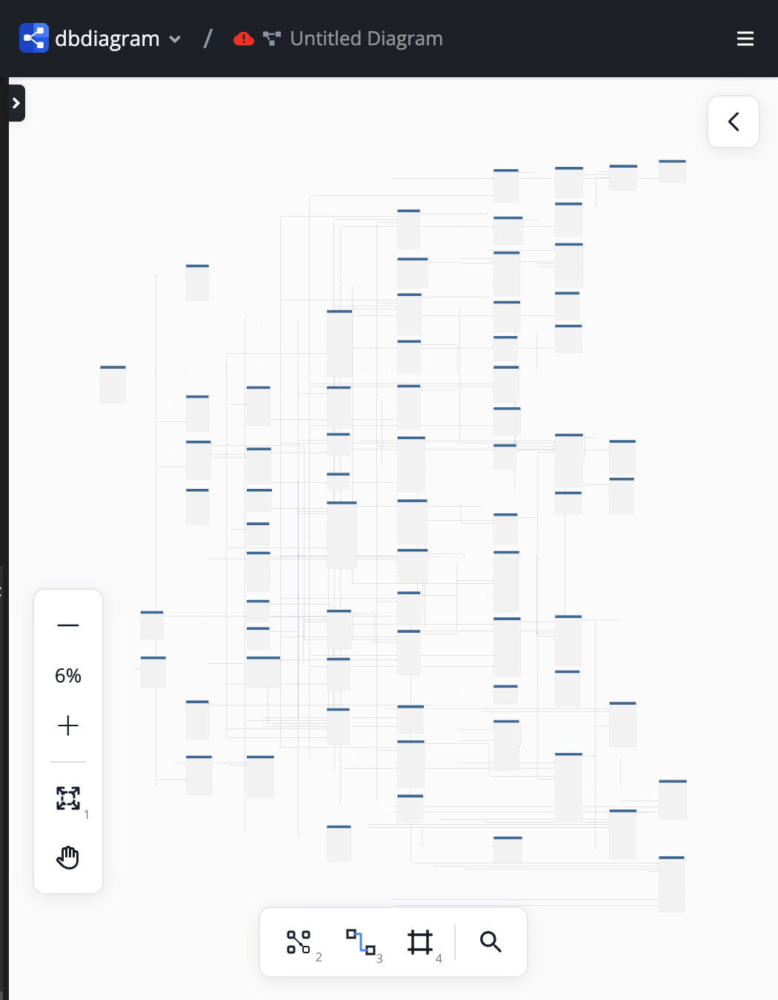

### 0.2 Năm nguyên tắc xuyên suốt

Mọi luồng bên dưới đều tuân theo 5 nguyên tắc này. Hiểu chúng thì đọc schema sẽ thấy nhất quán.

1. **Cô lập theo tổ chức.** Mọi bảng dữ liệu riêng có `organization_id`, hoặc đi tới được `organizations` qua khóa ngoại. Mọi truy vấn của ứng dụng phải lọc theo tổ chức của người dùng (AC-001-02).
2. **Chứng từ tiền là sổ cái chỉ thêm.** `payments`, `payment_allocations`, `deposit_transactions`, `fund_transactions` và `fund_offsets` không xóa được, không sửa được số tiền (trigger chặn). Ghi sai thì hủy (VOIDED/REVERSED) hoặc ghi bút toán đảo, rồi tạo bản mới.
3. **Số dư được tính, không lưu.** Công nợ, cọc khả dụng, quỹ khả dụng và tiền chưa phân bổ đều tính bằng tổng các dòng giao dịch (xem Phụ lục B). Không có cột "balance" nào có thể lệch với lịch sử. Riêng `checkouts` lưu ảnh chụp số liệu tại lúc quyết toán, và CHECK bảo đảm công thức đúng.
4. **Sửa bằng phiên bản, không sửa đè.** Các cặp `contract_versions`, `rent_rates`, `handovers.supersedes_handover_id`, `meter_readings.supersedes_reading_id`, `allocation_batches.revision_no`, `shared_purchase_revisions`, `residence_document_versions` và `business_policies.revision_no` giữ được bản cũ để truy vết.
5. **Chống ghi lặp (idempotency).** Mỗi thao tác có thể bị gửi lại đều có khóa unique: `payments.idempotency_key`, `invoices.generation_key`, `invoice_items.source_key`, `fund_transactions.idempotency_key`, `fund_offsets.idempotency_key`, `notifications.dedupe_key`, `reminders.reminder_key`, và bảng chung `idempotency_keys` (NFR03).

### 0.3 Ba tầng bảo vệ

Mỗi quy tắc nghiệp vụ được đặt ở tầng chặt nhất có thể:

| Tầng | Bảo vệ được gì | Ví dụ |
|---|---|---|
| **DB cứng** (CHECK, UNIQUE, FK, trigger) | Quy tắc chỉ cần nhìn một dòng, hoặc một tập dòng có khóa cố định | `current_value >= previous_value`; một hợp đồng ACTIVE mỗi phòng; không xóa phiếu thu |
| **Ứng dụng có khóa dòng** (`SELECT … FOR UPDATE` + `@Version`) | Quy tắc cần cộng dồn nhiều dòng | Tổng phân bổ ≤ số tiền phiếu; quỹ khả dụng không âm; sức chứa phòng |
| **Ứng dụng thuần** | Phân quyền, quy trình, thông báo | Kiểm quyền theo phạm vi; đủ 2 người xác nhận; gửi nhắc việc |

Trong tài liệu, ký hiệu 🔒 là được DB chặn cứng, 🧩 là ứng dụng Java phải tự làm.

---

## 1. Luồng phân quyền và truy cập (EP01)

**Bảng:** `users`, `roles`, `permissions`, `role_permissions`, `user_role_assignments`, `assignment_permission_grants`, `support_access_grants`, `audit_logs`.

### 1.1 Các bước

| # | Bước | Ghi | Đọc |
|---|---|---|---|
| 1 | Chủ trọ đăng ký, tạo tổ chức | `users`, `organizations`, `user_role_assignments` (role OWNER, `property_id` = NULL) | `roles` |
| 2 | Thêm nhân viên phụ trách một khu | `users`, `user_role_assignments` (STAFF, `property_id` = khu) | |
| 3 | Cấp quyền nhạy cảm riêng (thu tiền, hoàn cọc…) | `assignment_permission_grants` | `permissions.is_sensitive` |
| 4 | Người thuê đăng nhập | `users.last_login_at`, `failed_login_count` | `persons.user_id` → `occupancies` |
| 5 | Thu hồi phân công | `user_role_assignments.revoked_at/by` | |
| 6 | Admin nền tảng xin xem một hồ sơ | `support_access_grants` (có `valid_from/to`, `reason`) | |
| 7 | Mọi thao tác trên | `audit_logs` (action GRANT/REVOKE/LOGIN) | |

### 1.2 Cách xác định quyền của một request

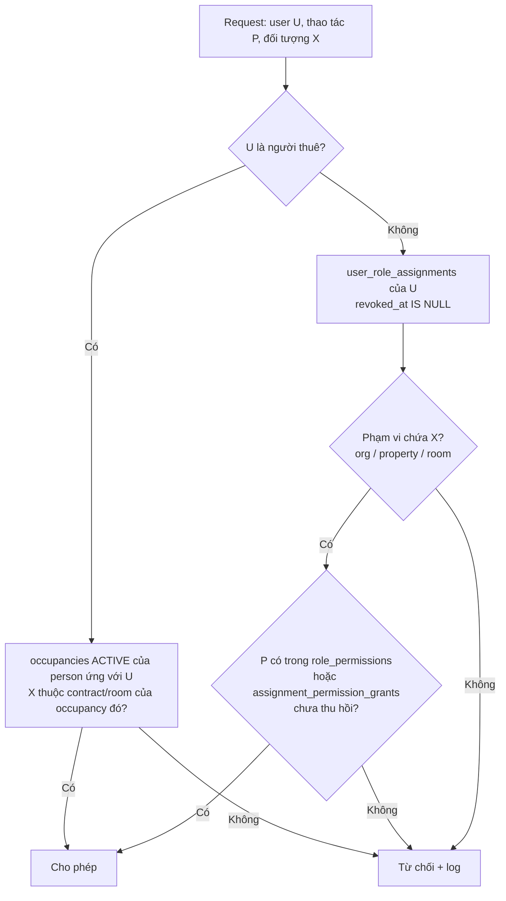

### 1.3 Ràng buộc

- 🔒 `ck_ura_room_needs_property`: phân công theo phòng thì bắt buộc có khu.
- 🔒 `ck_sag_valid_range`: quyền hỗ trợ phải có thời hạn dương.
- 🔒 `uq_role_permissions`: không gán trùng quyền cho vai trò.
- 🧩 Thu hồi phải có hiệu lực ngay ở request kế tiếp (AC-001-03). **Không cache quyền vào session**: đọc lại `revoked_at` mỗi request, hoặc cache với cơ chế xóa cache khi thu hồi.
- 🧩 Quyền `is_sensitive` chỉ OWNER có mặc định (V3). STAFF phải được cấp riêng qua bước 3.
- 🧩 Thông báo lỗi khi từ chối không được để lộ dữ liệu (GT-14).

---

## 2. Luồng thiết lập khu trọ, phòng, dịch vụ, chính sách (EP02, EP06)

**Bảng:** `organizations`, `properties`, `rooms`, `room_status_history`, `room_assets`, `services`, `service_prices`, `meters`, `business_policies`.

| # | Bước | Ghi |
|---|---|---|
| 1 | Tạo khu | `properties` (`code` unique trong tổ chức, `timezone` mặc định Asia/Ho_Chi_Minh) |
| 2 | Tạo phòng | `rooms` (`capacity`, `listed_rent`, `status` = VACANT) + `room_status_history` |
| 3 | Khai báo tài sản phòng | `room_assets` (`reference_value` chỉ để tham khảo, BR-018) |
| 4 | Khai báo dịch vụ | `services` (`calculation_method`, `person_day_eligible`) |
| 5 | Đặt giá dịch vụ | `service_prices` theo phạm vi tổ chức / khu / phòng, có `effective_from/to`, bậc giá ở `tiers_json` |
| 6 | Lắp đồng hồ | `meters` (`initial_value`, `status` = ACTIVE) |
| 7 | Chốt chính sách cho các câu hỏi mở | `business_policies` (revision mới, `status` = APPROVED, `decision_ref` = Q0x) |

**Trạng thái phòng:**

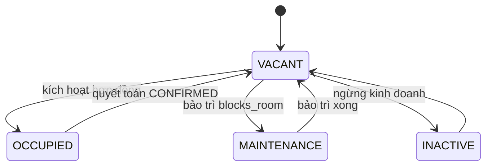

**Ràng buộc:**

- 🔒 `ck_rooms_capacity` (> 0), `ck_rooms_listed_rent` (≥ 0).
- 🔒 `uq_rooms_property_code`, `uq_properties_org_code`, `uq_services_org_code`.
- 🔒 `uq_meters_active`: mỗi phòng và dịch vụ chỉ một đồng hồ ACTIVE.
- 🔒 `ck_service_prices_room_needs_property`, `ck_service_prices_range`.
- 🔒 FK RESTRICT: không xóa được phòng đã có hợp đồng, chỉ đổi sang INACTIVE (AC-002-02).
- 🧩 Khoảng hiệu lực giá không được chồng nhau trong cùng phạm vi (BR-009). DB chỉ chặn trùng ngày bắt đầu, phần chồng khoảng ứng dụng phải kiểm.
- 🧩 Đổi `listed_rent` không ảnh hưởng hợp đồng đã ký, vì giá hợp đồng nằm ở `rent_rates`.
- 🧩 Mỗi lần đổi trạng thái phòng phải ghi thêm `room_status_history`.

**Giá chọn cho một dịch vụ tại ngày D:** ưu tiên giá theo phòng, sau đó theo khu, cuối cùng theo tổ chức.

```sql
SELECT * FROM service_prices
WHERE service_id = :svc
  AND effective_from <= :d AND (effective_to IS NULL OR effective_to >= :d)
  AND (room_id = :room OR (room_id IS NULL AND property_id = :prop) OR (room_id IS NULL AND property_id IS NULL))
ORDER BY (room_id IS NOT NULL) DESC, (property_id IS NOT NULL) DESC
LIMIT 1;
```

---

## 3. Luồng tiếp nhận người thuê → hợp đồng → cọc → nhận phòng (EP03, EP04, EP05)

**Bảng:** `persons`, `contracts`, `contract_versions`, `rent_rates`, `contract_services`, `occupancies`, `deposit_transactions`, `handovers`, `handover_items`, `meter_readings` (CHECK_IN), `room_funds`.

### 3.1 Trình tự

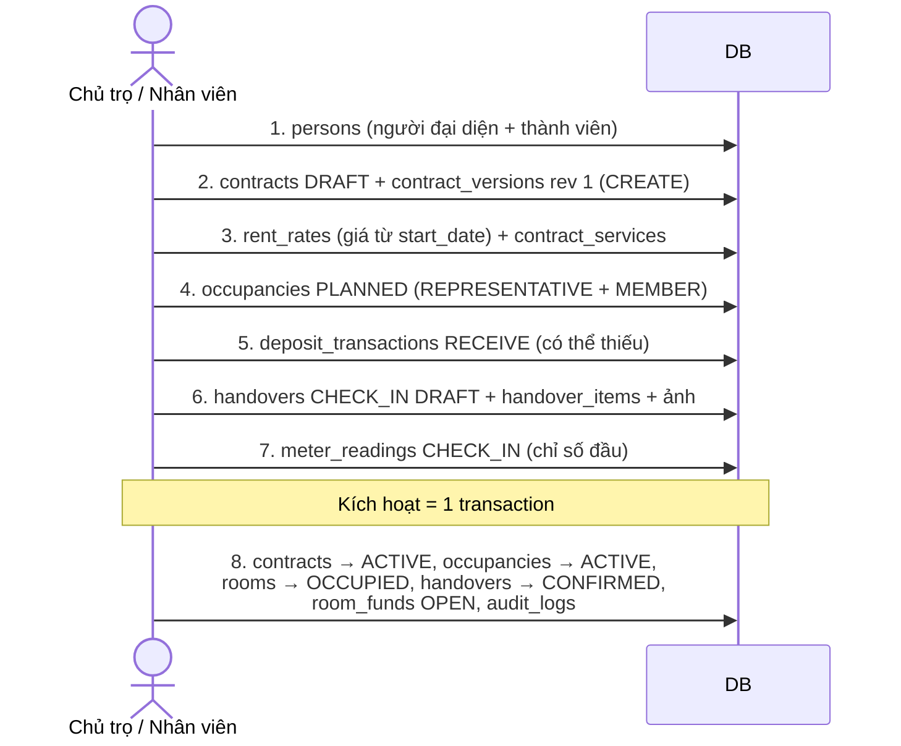

### 3.2 Chi tiết từng bước

| # | Bước | Ghi | Ràng buộc |
|---|---|---|---|
| 1 | Nhập người thuê | `persons` (chỉ bắt buộc `full_name`) | 🔒 `uq_persons_org_user`. 🧩 `identity_number` mã hóa ở tầng ứng dụng và không ghi vào log |
| 2 | Tạo hợp đồng nháp | `contracts` (status DRAFT, `billing_cycle`, `billing_anchor_day`, `payment_due_days`, `proration_policy`, `deposit_required`) + `contract_versions` (rev 1, change_type CREATE, `terms_json`) | 🔒 `ck_contracts_dates`, `ck_contracts_anchor_day` (1..28), `uq_contracts_org_code` |
| 3 | Giá thuê và dịch vụ | `rent_rates` (`effective_from` = start_date, `effective_to` NULL); `contract_services` | 🔒 `uq_rent_rates_contract_from`, `ck_rent_rates_range` |
| 4 | Thêm người ở | `occupancies` (PLANNED) | 🔒 `uq_occupancies_active_person`: một người không ở hai lượt hiệu lực trong cùng hợp đồng. 🔒 `uq_occupancies_active_representative`: chỉ một đại diện. 🧩 Số occupancies PLANNED/ACTIVE của phòng không được vượt `rooms.capacity` (BR-003): khóa dòng `rooms` rồi đếm |
| 5 | Nhận cọc | `deposit_transactions` (RECEIVE, `idempotency_key`) | 🔒 `amount > 0`, không sửa, không xóa. Nhận cọc thiếu vẫn ghi được (AC-004-03) |
| 6 | Biên bản nhận phòng | `handovers` (CHECK_IN, DRAFT), `handover_items` (`item_condition`), ảnh qua `file_links` (HANDOVER_ITEM) | 🔒 `uq_handovers_rev` |
| 7 | Chỉ số đầu | `meter_readings` (reading_type CHECK_IN, `period_id` NULL) | 🔒 `ck_meter_readings_monotonic` |
| 8 | **Kích hoạt** | `contracts.status` = ACTIVE, `activated_at/by`; occupancies → ACTIVE; rooms → OCCUPIED + `room_status_history`; handovers → CONFIRMED; tạo `room_funds` (nếu dùng quỹ); `audit_logs` | 🔒 `uq_contracts_active_room`: phòng đã có hợp đồng ACTIVE hoặc EXPIRED thì kích hoạt thất bại (BR-004, Q01). 🔒 `uq_handovers_confirmed`. 🔒 `uq_room_funds_open_contract` |

### 3.3 Trạng thái hợp đồng và lượt ở

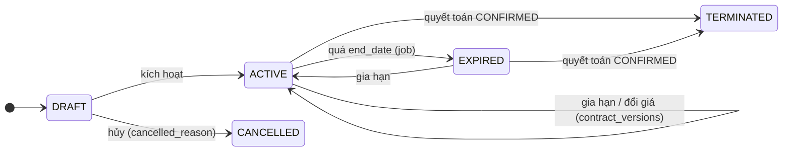

> **EXPIRED vẫn giữ phòng.** Hết hạn không tự kết thúc lượt ở và không tự hoàn cọc. Vì vậy `active_room_key` tính cho cả ACTIVE lẫn EXPIRED.

Lượt ở: `PLANNED → ACTIVE → ENDED`, hoặc `PLANNED → CANCELLED`. Một thành viên có thể ENDED giữa chừng (`move_out_date`) mà hợp đồng vẫn tiếp tục.

### 3.4 Ứng dụng phải tự làm

- 🧩 Không kích hoạt nếu phòng đang có `maintenance_requests.blocks_room = true` chưa xong.
- 🧩 Không kích hoạt nếu `proration_policy = NOT_SET` mà ngày bắt đầu nằm giữa kỳ (Q02 chưa chốt thì chặn chốt tiền).
- 🧩 Cọc thiếu (tổng RECEIVE < `deposit_required`) chỉ cảnh báo, không chặn.

---

## 4. Luồng ghi chỉ số và OCR (EP06)

**Bảng:** `billing_periods`, `meters`, `meter_readings`, `ocr_jobs`, `stored_files`, `file_links`.

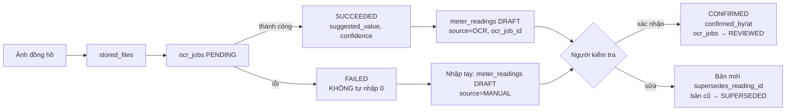

| # | Bước | Ghi | Ràng buộc |
|---|---|---|---|
| 1 | Mở kỳ thu | `billing_periods` (OPEN, `date_from/to` theo `billing_anchor_day` của hợp đồng) | 🔒 `uq_billing_periods_contract_from`, `uq_billing_periods_contract_code`, `ck_billing_periods_dates` |
| 2 | Nhập chỉ số | `meter_readings` DRAFT; `previous_value` lấy từ bản CONFIRMED gần nhất của cùng đồng hồ, hoặc `meters.initial_value` | 🔒 `ck_meter_readings_monotonic` (AC-008-02) |
| 3 | Bất thường | `is_anomaly`, `anomaly_note` (ví dụ tiêu thụ gấp 3 lần trung bình) | 🧩 Ứng dụng tự tính ngưỡng |
| 4 | Xác nhận | status CONFIRMED | 🔒 `uq_meter_readings_confirmed`: mỗi (đồng hồ, kỳ, loại đoạn) một bản CONFIRMED |
| 5 | Thay đồng hồ giữa kỳ | Đồng hồ cũ: `meters` → REPLACED, `final_value`, `removed_at`; reading REPLACEMENT_CLOSE. Đồng hồ mới: `meters` (ACTIVE, `replaced_meter_id`) + reading REGULAR từ `initial_value` | 🔒 `uq_meters_active` buộc phải đổi đồng hồ cũ khỏi ACTIVE trước, trong cùng transaction |

**GT-12:** Đồng hồ cũ đi từ 1.000 đến 1.080, đồng hồ mới từ 0 đến 20. Kết quả là 2 dòng `meter_readings`, tổng tiêu thụ là 80 + 20 = 100. Nếu không có thay đồng hồ mà nhập chỉ số cuối 990 thì `ck_meter_readings_monotonic` chặn.

**Ứng dụng phải tự làm:**

- 🧩 Chỉ bản CONFIRMED mới được dùng để lập hóa đơn (BR-008).
- 🧩 Kỳ đã LOCKED thì không sửa chỉ số; muốn sửa phải làm điều chỉnh hóa đơn.

---

## 5. Luồng lập hóa đơn kỳ (EP07)

**Bảng:** `billing_periods`, `invoices`, `invoice_items`, `rent_rates`, `contract_services`, `service_prices`, `meter_readings`, `allocation_batches`, `business_policies`.

### 5.1 Trình tự lập hóa đơn

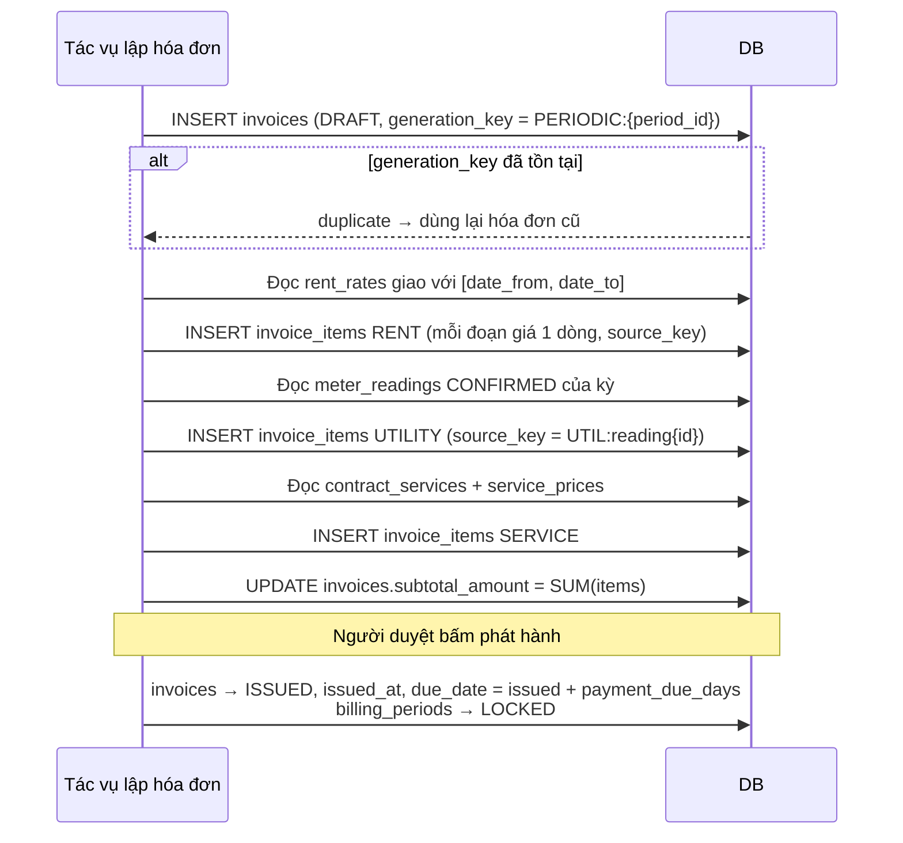

### 5.2 Chi tiết

| # | Bước | Ghi | Ràng buộc |
|---|---|---|---|
| 1 | Tạo hóa đơn nháp | `invoices` (PERIODIC, `period_id`, `generation_key`) | 🔒 `generation_key` unique (BR-010). 🔒 `uq_invoices_active_periodic`: mỗi kỳ một hóa đơn PERIODIC chưa hủy. 🔒 `ck_invoices_periodic_has_period` |
| 2 | Dòng tiền phòng | `invoice_items` RENT, `rent_rate_id`, `date_from/to`, `calculation_snapshot` | 🔒 `uq_invoice_items_source`: chạy lại không thêm dòng trùng (AC-007-03) |
| 3 | Dòng điện nước | `invoice_items` UTILITY, `meter_reading_id`; bậc giá tính từ `tiers_json` | |
| 4 | Dòng dịch vụ | `invoice_items` SERVICE (PER_ROOM, PER_PERSON = `quantity` số người…) | |
| 5 | Cộng tổng | `invoices.subtotal_amount` | 🔒 `ck_invoices_subtotal` (≥ 0) |
| 6 | Phát hành | status ISSUED, `issued_at/by`, `due_date`, `policy_snapshot`; kỳ → LOCKED | 🔒 Sau khi phát hành: `trg_invoice_items_draft_*` chặn thêm/sửa/xóa dòng; `trg_invoices_lock_issued_amount` chặn đổi tổng tiền, hợp đồng, kỳ; `trg_invoices_no_delete_issued` chặn xóa |
| 7 | Sửa sau phát hành | `invoice_adjustments` (`amount` âm hoặc dương, `reason`, DRAFT → APPROVED) | 🔒 `ck_invoice_adjustments_nonzero` |
| 8 | Hủy hóa đơn | status CANCELLED, `cancel_reason` | 🔒 `ck_invoices_cancel_reason`. Sau khi hủy, `active_periodic_key` = NULL nên tạo được hóa đơn thay thế cho cùng kỳ |

### 5.3 Trạng thái hóa đơn

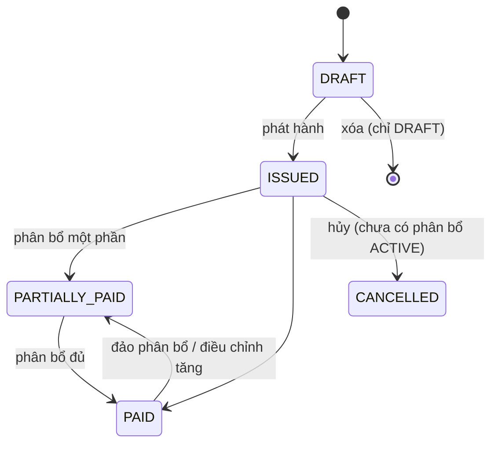

> `status` PARTIALLY_PAID/PAID chỉ là cache hiển thị. Ứng dụng cập nhật lại mỗi khi phân bổ hoặc điều chỉnh. Nguồn sự thật là công thức công nợ ở Phụ lục B. "Quá hạn" **không lưu**: đó là điều kiện `due_date < hôm nay AND công nợ > 0`.

### 5.4 Ví dụ GT-11: đổi giá hoặc vào ở giữa tháng

Tiền phòng 3.000.000/tháng, tháng 31 ngày, ở từ ngày 15 đến 31 là 17 ngày (tính cả hai đầu). Tiền phụ thuộc `contracts.proration_policy`:

| proration_policy | Công thức | Kết quả (làm tròn 1đ) |
|---|---|---|
| ACTUAL_DAYS_INCLUSIVE | 3.000.000 × 17 / 31 | 1.645.161 |
| FIXED_30_INCLUSIVE | 3.000.000 × 17 / 30 | 1.700.000 |
| FULL_MONTH | thu đủ tháng | 3.000.000 |
| NOT_SET | 🧩 chặn phát hành | — |

Nếu đổi giá giữa kỳ (AC-005-03), sẽ có 2 dòng `rent_rates` giao với kỳ, sinh ra 2 dòng `invoice_items` RENT với `date_from/to` riêng.

### 5.5 Ứng dụng phải tự làm

- 🧩 `subtotal_amount` phải bằng SUM(`invoice_items.amount`), cập nhật trong cùng transaction.
- 🧩 Không phát hành nếu còn đồng hồ thiếu chỉ số CONFIRMED trong kỳ. Thay vào đó tạo reminder MISSING_READING.
- 🧩 Điều chỉnh giảm làm phải thu nhỏ hơn số đã phân bổ: phải đảo phân bổ trước (BR-011).
- 🧩 Làm tròn theo `rounding_policy_id` (Q04: làm tròn 1 đồng).

---

## 6. Luồng thu tiền, phân bổ, tiền dư, đối soát (EP07)

**Bảng:** `payments`, `payment_allocations`, `overpayment_refunds`, `payment_reconciliations`, `invoices`, `idempotency_keys`.

### 6.1 Các bước

| # | Bước | Ghi | Ràng buộc |
|---|---|---|---|
| 1 | Nhận tiền | `payments` (CONFIRMED, `contract_id`, `amount`, `method`, `idempotency_key`, `received_by`) | 🔒 `idempotency_key` unique: gửi lặp không cộng tiền lần 2 (AC-011-02). 🔒 `ck_payments_amount` |
| 2 | Phân bổ vào hóa đơn | `payment_allocations` (ACTIVE) | 🔒 `uq_payment_allocations_active`: không phân bổ trùng phiếu vào cùng hóa đơn. 🧩 Tổng phân bổ ACTIVE của phiếu ≤ `amount`; của hóa đơn ≤ phải thu hiệu lực. Khóa `payments` và `invoices` bằng `FOR UPDATE` |
| 3 | Cập nhật trạng thái hóa đơn | `invoices.status` | 🧩 |
| 4 | Tiền dư | Không ghi gì. Tiền dư = `amount` − phân bổ ACTIVE − `overpayment_refunds` | Q05: giữ riêng, **không tự chuyển vào cọc hay quỹ** (GT-09) |
| 5a | Dùng tiền dư cho kỳ sau | `payment_allocations` mới từ cùng phiếu sang hóa đơn kỳ sau | |
| 5b | Hoàn tiền dư | `overpayment_refunds` (`approved_by`, `idempotency_key`) | 🔒 `ck_overpayment_refunds_amount` |
| 6 | Ghi sai phiếu | Phiếu cũ: status VOIDED, `void_reason`; mọi phân bổ → REVERSED. Phiếu mới: `corrects_payment_id` = phiếu cũ | 🔒 `trg_payments_immutable` (không đổi số tiền, không khôi phục VOIDED), `trg_payments_no_delete`, `ck_payments_void_reason`, `trg_payment_allocations_*` |
| 7 | Đối soát ngân hàng | `payment_reconciliations` (PENDING → MATCHED/MISMATCHED) | Q08 |

### 6.2 Ví dụ

**GT-08:** Hóa đơn 1.000.000.

| Thời điểm | payments | payment_allocations | Công nợ |
|---|---|---|---|
| Thu lần 1 | P1 600.000 | P1 → HĐ 600.000 | 400.000 |
| Gửi lặp P1 | bị `idempotency_key` chặn | — | 400.000 |
| Thu lần 2 | P2 400.000 | P2 → HĐ 400.000 | 0 → PAID |

**GT-09:** Hóa đơn 1.000.000, nhận 1.200.000. Phân bổ 1.000.000, còn 200.000 chưa phân bổ nằm trên chính phiếu đó. Cọc và quỹ không đổi.

**GT-15:** Phải thu 1.000.000, thu tiền thuê 600.000, nhận cọc 2.000.000, thu quỹ 200.000, chi vận hành 100.000. Báo cáo doanh thu chỉ cộng `payments` CONFIRMED (600.000). Cọc nằm ở `deposit_transactions`, quỹ ở `fund_transactions`, chi phí ở `operating_expenses`. Bốn nguồn tách biệt nên không thể trộn lẫn (BR-036, BR-037).

---

## 7. Luồng gia hạn, đổi giá, đổi điều khoản (EP04)

**Bảng:** `contracts`, `contract_versions`, `rent_rates`, `contract_services`.

| Thao tác | contract_versions | Bảng khác |
|---|---|---|
| Gia hạn | rev mới, RENEW, `end_date` mới | `contracts.end_date` cập nhật; nếu đang EXPIRED thì về ACTIVE |
| Đổi giá | rev mới, PRICE_CHANGE, `effective_from` | Đóng `rent_rates` cũ (`effective_to` = ngày trước), thêm `rent_rates` mới gắn `contract_version_id` |
| Đổi điều khoản / dịch vụ | rev mới, TERMS_CHANGE, `terms_json` | `contract_services`: đóng dòng cũ, thêm dòng mới |
| Kết thúc sớm | rev mới, EARLY_TERMINATE | `contracts.end_date` mới, rồi chuyển sang luồng trả phòng |

**Ràng buộc:**

- 🔒 `uq_contract_versions_rev`, `ck_contract_versions_dates`.
- 🔒 `uq_rent_rates_contract_from`, `ck_rent_rates_range`.
- 🧩 Khoảng `rent_rates` của một hợp đồng phải liền mạch, không chồng, không hở.
- 🧩 Đổi giá không sửa hóa đơn đã phát hành. Nếu ngày hiệu lực lùi về kỳ đã LOCKED thì làm `invoice_adjustments`.
- 🧩 Bản `contract_versions` DRAFT phải được APPROVED (`approved_by/at`) mới áp vào `contracts` và `rent_rates`.

---

## 8. Luồng Ngày Người — chia điện nước theo ngày ở thực tế (EP10)

**Bảng:** `occupancies`, `absence_requests`, `allocation_batches`, `person_day_allocations`, `invoices`, `invoice_adjustments`, `business_policies`.

### 8.1 Trình tự

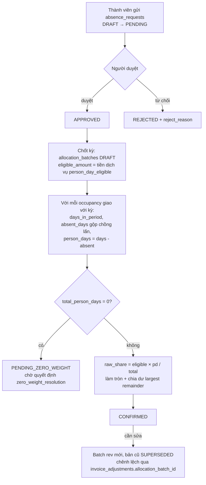

### 8.2 Ràng buộc

- 🔒 `ck_absence_dates`.
- 🔒 `ck_pda_person_days`: `person_days = days_in_period − absent_days`.
- 🔒 `ck_pda_days`, `ck_pda_amount`.
- 🔒 `ck_allocation_batches_zero_weight`: không được CONFIRMED khi tổng Ngày Người bằng 0 (BR-024, GT-04).
- 🔒 `uq_allocation_batches_confirmed`: mỗi kỳ và dịch vụ chỉ một phiên CONFIRMED (AC-016-04).
- 🔒 `uq_person_day_alloc`, `uq_allocation_batches_rev`.
- 🧩 Khoảng vắng phải nằm trong thời gian cư trú (AC-015-03).
- 🧩 Chỉ đơn APPROVED mới bị trừ (BR-022). Các khoảng chồng nhau phải gộp trước khi đếm.
- 🧩 Tổng `allocated_amount` phải bằng `eligible_amount`. Chia phần dư theo phần thập phân lớn nhất (Q04); khi bằng nhau thì xếp theo mã người, ghi thứ tự vào `remainder_rank`.
- 🧩 `absence_requests.reason` là dữ liệu riêng tư: thành viên khác không được xem (BR-002).
- 🧩 Chia Ngày Người **không đổi tổng hóa đơn phòng** (BR-023). Nó chỉ cho biết mỗi người chịu bao nhiêu.

### 8.3 Ví dụ

| GT | Đầu vào | Kết quả trong DB |
|---|---|---|
| GT-01 | A 16, B 20, C 30, D 30 ngày; tiền 960.000 | `total_person_days` = 96; `allocated_amount` lần lượt 160.000 / 200.000 / 300.000 / 300.000 |
| GT-02 | Kỳ 30 ngày; vắng ngày 5–10 và 8–12, cả hai APPROVED | Gộp thành 5–12 = 8 ngày; `absent_days` = 8, `person_days` = 22 |
| GT-03 | 100.000; A, B, C mỗi người 1 ngày | `raw_share` 33.333,33 mỗi người; A nhận 1đ dư (`remainder_rank` = 1) → 33.334 / 33.333 / 33.333 |
| GT-04 | 960.000; tổng Ngày Người = 0 | Batch ở PENDING_ZERO_WEIGHT; CHECK chặn CONFIRMED |

---

## 9. Luồng quỹ phòng, mua chung, bù trừ (EP11)

Đây là luồng phức tạp nhất. Quỹ là tiền của nhóm người thuê, không phải của chủ trọ.

**Bảng:** `room_funds`, `fund_managers`, `fund_obligations`, `fund_transactions`, `shared_purchases`, `shared_purchase_revisions`, `purchase_approvals`, `fund_reservations`, `fund_refund_entitlements`, `fund_offsets`.

### 9.1 Mô hình tiền

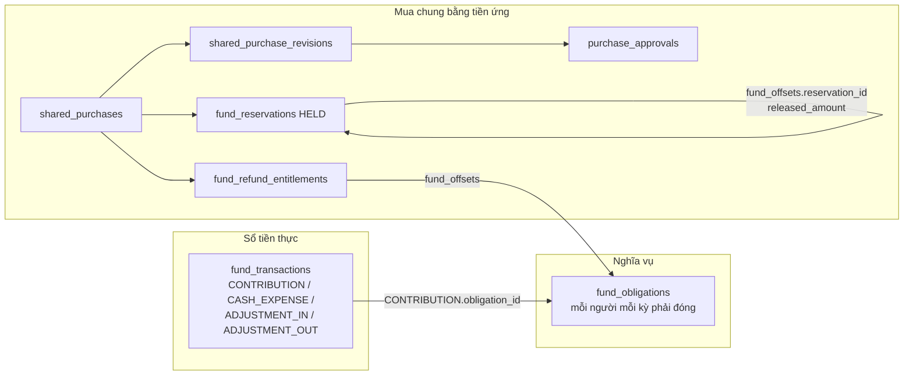

- **Tiền thực có** = CONTRIBUTION + ADJUSTMENT_IN − CASH_EXPENSE − ADJUSTMENT_OUT.
- **Khả dụng** = tiền thực có − Σ(`amount` − `released_amount`) của các reservation HELD.
- **Còn phải nộp** của một obligation = `amount_due` − Σ CONTRIBUTION gắn obligation đó − Σ `fund_offsets` gắn obligation đó.

### 9.2 Đóng quỹ hằng kỳ

1. Đầu kỳ tạo `fund_obligations` cho mỗi occupancy ACTIVE (🔒 `uq_fund_obligations`).
2. Thành viên nộp tiền: `fund_transactions` CONTRIBUTION với `occupancy_id` và `obligation_id` (🔒 `ck_fund_transactions_contribution`, 🔒 `idempotency_key` nên tăng quỹ đúng một lần, AC-017-01).
3. Nộp đủ thì obligation → SETTLED.

### 9.3 Mua chung bằng tiền ứng trước

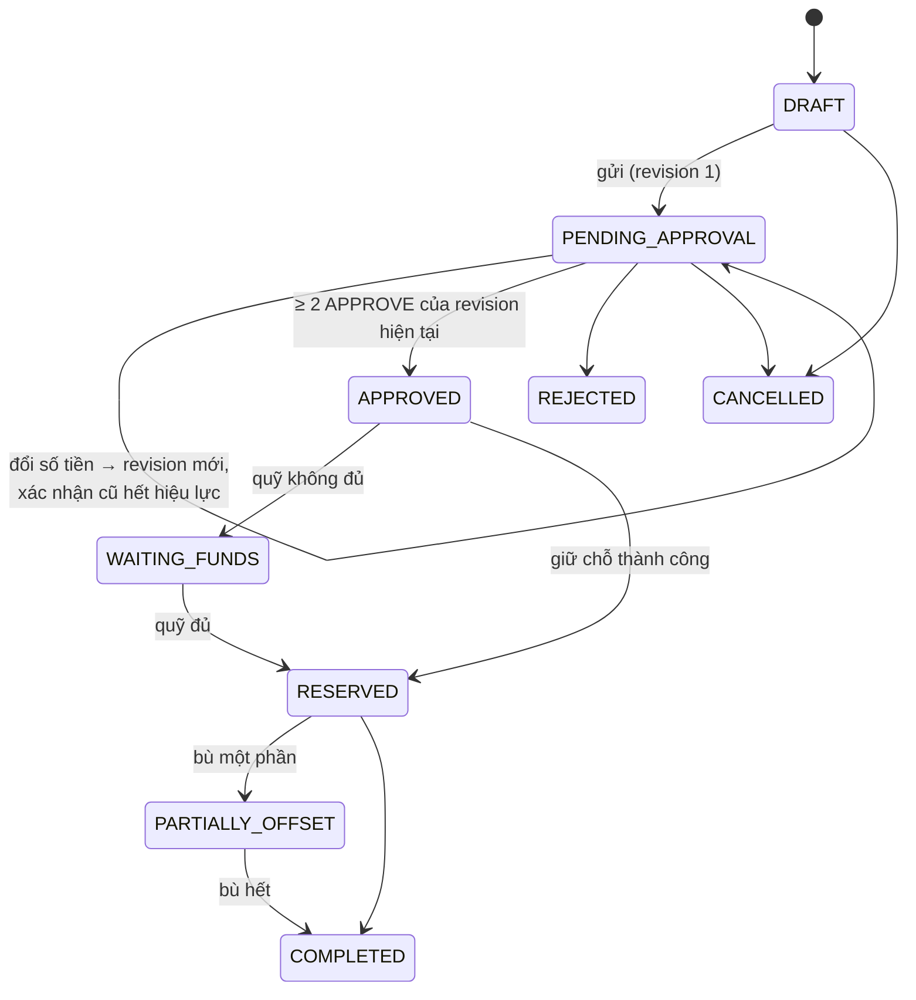

| # | Bước | Ghi | Ràng buộc |
|---|---|---|---|
| 1 | A ứng tiền mua đồ, tạo đề nghị | `shared_purchases` (`requested_by_occupancy_id` = A) + `shared_purchase_revisions` rev 1 (`amount`, chứng từ qua `file_links` PURCHASE_REVISION) | 🔒 `ck_purchase_revisions_amount`, `uq_purchase_revisions` |
| 2 | Thành viên khác xác nhận | `purchase_approvals` (`revision_no`, `approver_occupancy_id`, APPROVE/REJECT) | 🔒 `trg_purchase_approvals_rules`: A không tự duyệt được; chỉ duyệt được revision hiện tại. 🔒 `uq_purchase_approvals`: một người xác nhận hai lần chỉ tính một. 🧩 Đếm đủ ≥ 2 APPROVE (Q09) |
| 3 | Đổi số tiền | Thêm revision mới, `current_revision_no` + 1 | Xác nhận của revision cũ tự hết hiệu lực vì trigger chỉ nhận revision hiện tại (BR-026) |
| 4 | Giữ chỗ quỹ | `fund_reservations` HELD; `fund_refund_entitlements` (A, `amount`, `remaining_amount` = `amount`) | 🔒 `uq_fund_reservations_held`. 🔒 `purchase_id` unique ở entitlement (quan hệ 1-1). 🧩 **Khóa `room_funds` FOR UPDATE**, tính khả dụng, chỉ giữ khi đủ (BR-027) |
| 5 | Bù trừ vào nghĩa vụ của A | `fund_offsets` (entitlement, obligation của A, reservation, `amount`, `idempotency_key`); giảm `remaining_amount`; tăng `released_amount` | 🔒 `fund_offsets` bất biến (trigger). 🔒 `idempotency_key`: chạy lại không bù lần 2 (AC-019-03). 🔒 `ck_entitlements_remaining`, `ck_fund_reservations_released`. 🧩 `amount` ≤ min(`remaining_amount`, còn phải nộp) |
| 6 | Hết quyền hoàn | entitlement → EXHAUSTED; reservation → RELEASED; purchase → COMPLETED | |
| 7 | A rời phòng còn quyền hoàn | entitlement → ON_HOLD, chờ xử lý theo Q09 | Không tự xóa |
| 8 | Đóng quỹ | `room_funds` → CLOSED, `close_note` | 🧩 Phải xử lý hết entitlement ACTIVE/ON_HOLD trước khi đóng |

> **Bù trừ không tạo `fund_transactions`.** Không có tiền mặt nào đi ra hay vào quỹ: A đã ứng tiền mua đồ, nay được miễn phần đóng quỹ tương ứng (BR-030, AC-017-02). `CASH_EXPENSE` chỉ dùng khi quỹ thật sự chi tiền mặt.

> **Không bù vào hóa đơn của chủ trọ** (BR-028). `fund_offsets.obligation_id` chỉ trỏ tới `fund_obligations`.

### 9.4 Ví dụ

| GT | Tình huống | Kết quả trong DB |
|---|---|---|
| GT-05 | A tạo đề nghị và tự duyệt; B xác nhận 2 lần; rồi C xác nhận | Lượt của A bị trigger chặn; lần 2 của B bị unique chặn; có C mới đủ 2 APPROVE → APPROVED |
| GT-06 | Nghĩa vụ 200.000, quyền hoàn 120.000 | `fund_offsets` 120.000; A nộp CONTRIBUTION 80.000; entitlement còn 0 → EXHAUSTED |
| GT-07 | Nghĩa vụ 100.000, quyền hoàn 120.000 | `fund_offsets` 100.000; A nộp 0; entitlement còn 20.000, giữ ACTIVE sang kỳ sau (BR-029) |
| GT-13 | Quỹ khả dụng 150.000; hai đề nghị cùng xin giữ 100.000 | Request 1 khóa `room_funds`, giữ 100.000, khả dụng còn 50.000. Request 2 chờ khóa, thấy không đủ → WAITING_FUNDS. Khả dụng không bao giờ âm |

---

## 10. Luồng trả phòng và quyết toán (EP08)

**Bảng:** `checkouts`, `checkout_deductions`, `handovers` (CHECK_OUT), `handover_items`, `meter_readings` (CHECK_OUT), `invoices` (CHECKOUT), `deposit_transactions`, `occupancies`, `contracts`, `rooms`, `fund_refund_entitlements`.

### 10.1 Trình tự

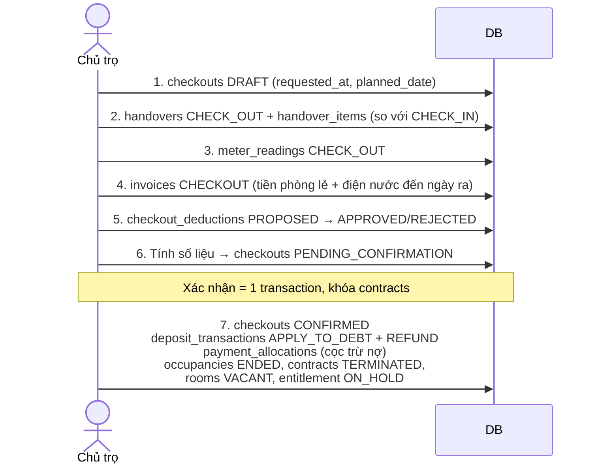

### 10.2 Công thức quyết toán (CHECK trong DB)

```
total_obligation  = outstanding_debt + extra_deductions
deposit_used      = MIN(deposit_available, total_obligation)
refund_amount     = deposit_available − deposit_used
extra_charge      = total_obligation − deposit_used
```

Trong đó:

- `outstanding_debt`: tổng công nợ mọi hóa đơn chưa hủy của hợp đồng, kể cả hóa đơn CHECKOUT.
- `extra_deductions`: tổng `checkout_deductions` APPROVED **mà `included_in_invoice_item_id` IS NULL**. Khấu trừ đã nằm trong hóa đơn thì đã có trong nợ, không cộng lần hai (BR-017).
- `deposit_available`: RECEIVE − APPLY_TO_DEBT − REFUND.

🔒 Bốn CHECK `ck_checkouts_total_obligation`, `ck_checkouts_deposit_used`, `ck_checkouts_refund`, `ck_checkouts_extra_charge` và `ck_checkouts_nonnegative` bảo đảm không thể lưu một quyết toán sai công thức.

### 10.3 Ví dụ GT-10 (AC-012-02)

| Trường | Trường hợp A: hư hỏng chưa có trong nợ | Trường hợp B: hư hỏng đã có trong hóa đơn |
|---|---|---|
| outstanding_debt | 800.000 | 1.100.000 |
| extra_deductions | 300.000 | 0 (`included_in_invoice_item_id` có giá trị) |
| total_obligation | 1.100.000 | 1.100.000 |
| deposit_available | 2.000.000 | 2.000.000 |
| deposit_used | 1.100.000 | 1.100.000 |
| refund_amount | **900.000** | **900.000** |
| extra_charge | 0 | 0 |

Nếu cọc chỉ có 1.000.000 thì `deposit_used` = 1.000.000, `refund_amount` = 0, `extra_charge` = 100.000 (người thuê còn phải trả thêm).

### 10.4 Ràng buộc chống lặp

- 🔒 `uq_checkouts_active_contract`: mỗi hợp đồng tối đa một quyết toán chưa hủy. Bấm xác nhận hai lần không tạo hai lần hoàn cọc (AC-012-04).
- 🔒 `trg_checkouts_lock_confirmed`: đã CONFIRMED thì không đổi được số tiền và không quay lại trạng thái khác.
- 🔒 `deposit_transactions` bất biến; REFUND có `checkout_id`.

### 10.5 Ứng dụng phải tự làm

- 🧩 Khấu trừ PROPOSED hoặc REJECTED không được tính (AC-006-03). Khấu trừ phải có căn cứ là ảnh và handover_item (BR-018).
- 🧩 Khi xác nhận: khóa `contracts` FOR UPDATE, tính lại toàn bộ số liệu từ sổ cái, so với số trên `checkouts` (`version`), rồi mới ghi.
- 🧩 Phần cọc dùng trừ nợ: ghi `deposit_transactions` APPLY_TO_DEBT. Để hóa đơn hết nợ, cần một `payments` (method OTHER, ghi chú "cấn trừ cọc", `external_reference` = id của deposit transaction) kèm `payment_allocations`. Cách này giữ được quy tắc "công nợ chỉ giảm qua phân bổ". **Điểm cần nhóm chốt:** báo cáo "tiền mặt đã thu" phải loại các phiếu cấn trừ này, nếu không sẽ đếm cọc hai lần. Có thể lọc theo quy ước ở trên, hoặc thêm một giá trị `DEPOSIT_OFFSET` vào enum `payment_method` cho rõ ràng.
- 🧩 Đánh dấu entitlement quỹ của các occupancy rời phòng thành ON_HOLD.

---

## 11. Luồng bảo trì và tranh chấp (EP09)

### 11.1 Bảo trì

**Bảng:** `maintenance_requests`, `maintenance_status_history`, `operating_expenses`, `invoice_items` (MAINTENANCE_RECHARGE), `file_links`.

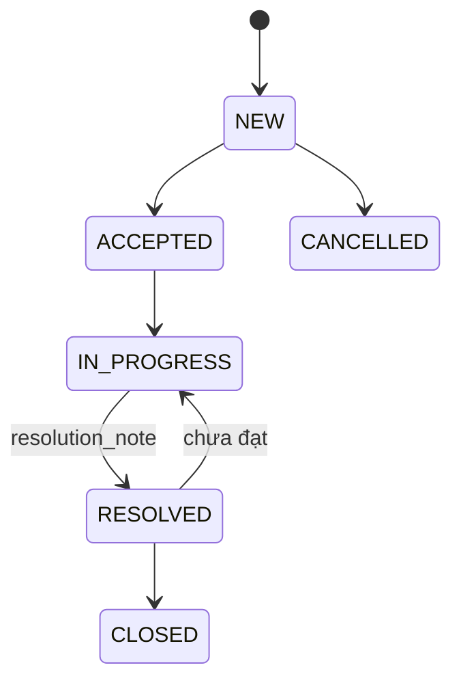

| Bước | Ghi |
|---|---|
| Người thuê báo hỏng | `maintenance_requests` NEW (+ ảnh `file_links` MAINTENANCE); `blocks_room` nếu không ở được |
| Mỗi lần đổi trạng thái | `maintenance_status_history` (người, thời điểm, ghi chú; AC-013-02) |
| Chi phí sửa | `operating_expenses` (`maintenance_request_id`, REPAIR). Chỉ ghi chi phí ở đây, không có cột cost trên request |
| Thu lại người thuê (nếu lỗi do người thuê) | `invoice_items` MAINTENANCE_RECHARGE trên hóa đơn ONE_OFF hoặc kỳ sau; trỏ ngược qua `recharge_invoice_item_id` (BR-019) |

### 11.2 Tranh chấp

**Bảng:** `disputes`, `dispute_parties`, `dispute_events`, `invoice_adjustments`.

| Bước | Ghi | Ghi chú |
|---|---|---|
| Mở tranh chấp về hóa đơn/cọc/biên bản | `disputes` OPEN (`entity_type`, `entity_id`) + `dispute_parties` (OPENER, RESPONDENT, HANDLER) | 🔒 `uq_dispute_parties` |
| Trao đổi, bằng chứng | `dispute_events` (COMMENT, EVIDENCE, STATUS_CHANGE) | 🧩 Chỉ các bên trong `dispute_parties` được đọc (AC-014-02) |
| Giải quyết có đổi tiền | `invoice_adjustments` có `dispute_id`, APPROVED | Mở tranh chấp **không tự xóa nợ** (BR-020, AC-014-03) |
| Đóng | `disputes` RESOLVED/REJECTED → CLOSED, `resolution` | |

---

## 12. Luồng hồ sơ cư trú, PDF và tệp (EP12)

**Bảng:** `residence_form_templates`, `residence_documents`, `residence_document_versions`, `stored_files`, `file_links`, `file_access_logs`, `absence_requests`.

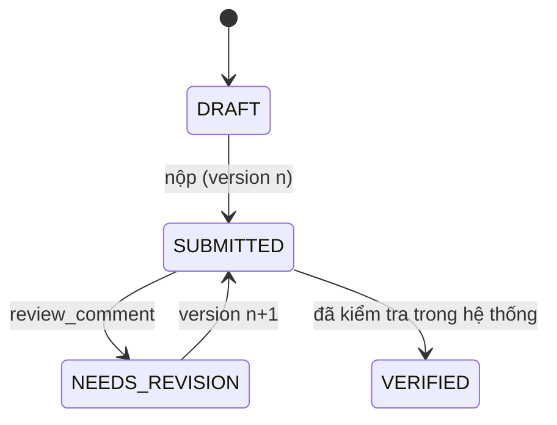

| Bước | Ghi | Ràng buộc |
|---|---|---|
| Chọn mẫu | đọc `residence_form_templates` ACTIVE (`schema_json`) | 🔒 `uq_residence_templates` |
| Điền hồ sơ | `residence_documents` + `residence_document_versions` (rev 1, `template_id`, `form_data`) | 🔒 `uq_residence_doc_versions`. 🧩 Kiểm trường bắt buộc theo `schema_json` |
| Kiểm tra | version: `review_decision`, `review_comment`, `reviewed_by/at`; document: status | 🧩 VERIFIED chỉ có nghĩa là đã kiểm trong hệ thống, **không phải đã hoàn tất thủ tục với cơ quan** (BR-031, AC-021-03). Giao diện phải ghi rõ |
| Xuất PDF | `stored_files` (PRIVATE) → `residence_document_versions.pdf_file_id` | PDF gắn đúng phiên bản (AC-021-01) |
| Hồ sơ tạm vắng → đề nghị vắng | `absence_requests.residence_document_id` | AC-020-03 |
| Tải tệp | `file_access_logs` (ALLOWED/DENIED) | 🧩 Kiểm quyền qua đối tượng chứa tệp (`file_links`); biết `storage_key` cũng không tải được (BR-032). Ghi log cả lần bị từ chối (GT-14) |

---

## 13. Luồng tìm phòng và lịch xem phòng (EP13)

**Bảng:** `room_listings`, `rental_inquiries`, `viewing_appointments`, `appointment_history`, `file_links` (ảnh PUBLIC).

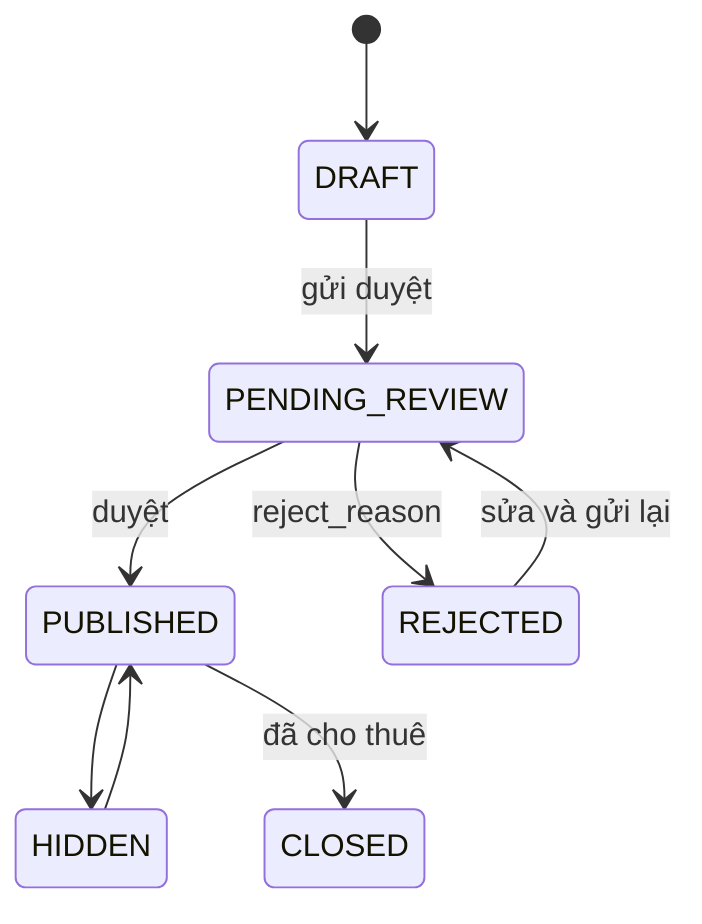

| Bước | Ghi | Ràng buộc |
|---|---|---|
| Đăng tin | `room_listings` DRAFT → PENDING_REVIEW | 🔒 `ck_listings_price`, `ck_listings_reject_reason`. 🧩 `public_address` chỉ chứa phần chủ trọ cho phép công khai |
| Khách tìm | đọc `room_listings` WHERE status = PUBLISHED (index `idx_listings_search`) | BR-033. Đăng tin không đổi `rooms.status` |
| Khách hỏi thuê | `rental_inquiries` NEW (khách có thể không đăng nhập) | 🧩 Tin CLOSED không nhận yêu cầu mới (AC-023-03) |
| Hẹn xem | `viewing_appointments` PROPOSED → CONFIRMED | 🔒 `ck_appointments_duration`. 🧩 Kiểm trùng lịch của nhân viên qua `idx_appointments_staff_time` |
| Đổi hoặc hủy lịch | `appointment_history` (`old/new_scheduled_at`) | AC-024-02 |
| Xem xong | COMPLETED | Không tự tạo hợp đồng hay thu cọc (BR-034, AC-024-03). Muốn thuê thì bắt đầu luồng 3 |

---

## 14. Luồng chi phí vận hành và báo cáo (EP14)

**Bảng:** `operating_expenses`, cùng các bảng tiền ở luồng 6, 3 và 9.

| Bước | Ghi | Ràng buộc |
|---|---|---|
| Ghi chi phí | `operating_expenses` RECORDED (`category`, `amount`, `document_ref`) | 🔒 `ck_expenses_amount`. 🔒 `uq_expenses_org_docref`: không ghi trùng chứng từ (AC-025-02) |
| Sửa | Bản cũ VOIDED (`void_reason`) + bản mới `replaces_expense_id` | 🔒 `ck_expenses_void_reason`. Bản gốc được giữ (AC-025-03) |

**Báo cáo thu chi theo khu và tháng (GT-15):**

| Chỉ tiêu | Nguồn |
|---|---|
| Phải thu | Σ `invoices.subtotal_amount` (ISSUED/PARTIALLY_PAID/PAID) + Σ `invoice_adjustments` APPROVED |
| Đã thu | Σ `payments.amount` CONFIRMED |
| Công nợ | Phải thu − Σ `payment_allocations` ACTIVE |
| Chi vận hành | Σ `operating_expenses` RECORDED |
| Cọc đang giữ | Σ `deposit_transactions` theo dấu (báo cáo riêng, không cộng vào doanh thu) |
| Quỹ phòng | Không thuộc báo cáo của chủ trọ (BR-036) |

---

## 15. Luồng nhắc việc và thông báo (EP14)

**Bảng:** `reminders`, `notifications`, `users`.

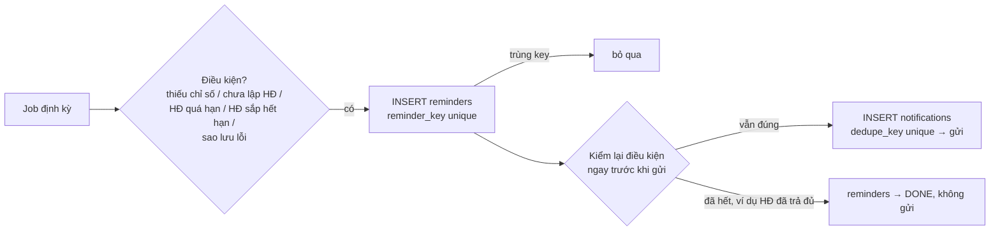

- 🔒 `reminder_key` (ví dụ `INVOICE_OVERDUE:INVOICE:15:2026-11-10`) chặn tạo nhắc trùng (BR-035).
- 🔒 `dedupe_key` chặn gửi lặp khi job chạy lại (AC-027-03).
- 🧩 Kiểm lại điều kiện trước khi gửi (AC-027-02). Kênh gửi theo Q11. Gửi lỗi thì tăng `attempt_count`, ghi `last_error`.

---

## 16. Luồng nhật ký, chống lặp, sao lưu (EP15)

### 16.1 Nhật ký

- `audit_logs` ghi mọi thao tác quan trọng: phát hành/hủy hóa đơn, thu tiền, hủy phiếu, quyết toán, cấp/thu hồi quyền, đăng nhập, tải tệp nhạy cảm.
- 🔒 `trg_audit_logs_no_update` / `trg_audit_logs_no_delete`: chỉ được thêm (BR-038, AC-028-02).
- 🧩 `before_json`/`after_json` không chứa mật khẩu, secret, hay số giấy tờ đầy đủ. `request_id` dùng để tra lỗi (NFR07).

### 16.2 Chống lặp cho request

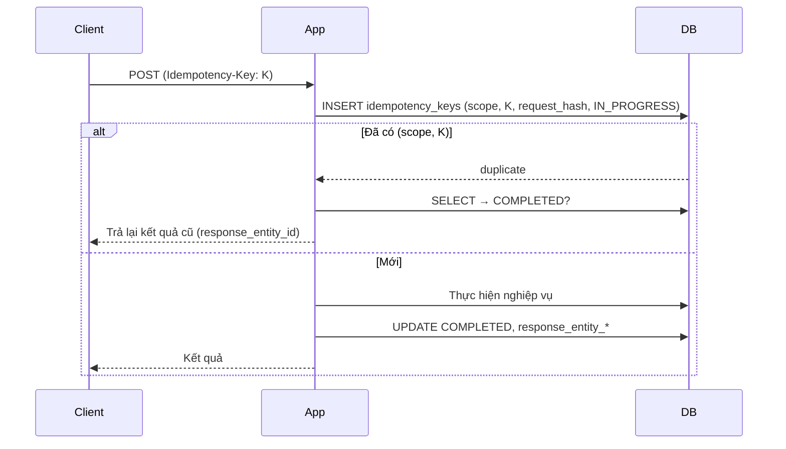

🧩 Cùng key nhưng `request_hash` khác thì trả lỗi 422, không thực hiện.

### 16.3 Sao lưu và khôi phục thử (Q12: hằng ngày, RPO 24h, RTO 4h)

| Bước | Ghi |
|---|---|
| Bắt đầu sao lưu | `backup_jobs` RUNNING |
| Kết thúc | SUCCEEDED (`manifest_file_id`, `database_checksum`, `files_count`) hoặc FAILED (`error_message`) + `reminders` BACKUP_FAILED (AC-029-01) |
| Khôi phục thử | `restore_tests` (môi trường tách biệt, `target/measured_rpo/rto_minutes`, `checks_json` đối chiếu số dư, số hợp đồng, PDF, ảnh) |
| Đánh giá | 🧩 Chỉ PASSED khi đối chiếu khớp, không chỉ vì có tệp sao lưu (AC-029-03, GT-16) |

---

## Phụ lục A. Ma trận bảng × luồng

Ký hiệu: **W** là luồng ghi chính, r là chỉ đọc.

| Nhóm / Bảng | 1 Quyền | 2 Thiết lập | 3 Tiếp nhận | 4 Chỉ số | 5 Hóa đơn | 6 Thu tiền | 7 Gia hạn | 8 Ngày Người | 9 Quỹ | 10 Trả phòng | 11 Bảo trì/TC | 12 Cư trú | 13 Tìm phòng | 14 Chi phí | 15 Nhắc | 16 Nhật ký |
|---|---|---|---|---|---|---|---|---|---|---|---|---|---|---|---|---|
| users, roles, permissions, role_permissions | **W** | r | r | | | | | | | | r | | | | r | r |
| user_role_assignments, assignment_permission_grants, support_access_grants | **W** | | | | | r | | | | r | | r | | | | |
| organizations, properties | r | **W** | r | | | | | | | | | | r | r | | |
| rooms, room_status_history | | **W** | **W** | | | | | | | **W** | **W** | | r | | | |
| business_policies | | **W** | r | | r | | | r | | | | | | | | |
| persons | r | | **W** | | | | | | | | | r | | | | |
| contracts, contract_versions | | | **W** | | r | r | **W** | | | **W** | r | r | | | r | |
| rent_rates, contract_services | | | **W** | | r | | **W** | | | | | | | | | |
| occupancies | r | | **W** | | | | | r | r | **W** | | | | | | |
| deposit_transactions | | | **W** | | | | | | | **W** | | | | r | | |
| room_assets, handovers, handover_items | | **W** | **W** | | | | | | | **W** | | | | | | |
| services, service_prices | | **W** | r | | r | | | r | | | | | | | | |
| meters, meter_readings, ocr_jobs | | **W** | **W** | **W** | r | | | | | **W** | | | | | r | |
| billing_periods | | | | **W** | **W** | | | r | | | | | | | r | |
| invoices, invoice_items | | | | | **W** | r | | r | | **W** | **W** | | | r | r | |
| invoice_adjustments | | | | | **W** | | r | **W** | | | **W** | | | r | | |
| payments, payment_allocations, overpayment_refunds, payment_reconciliations | | | | | | **W** | | | | **W** | | | | r | | |
| checkouts, checkout_deductions | | | | | | | | | | **W** | r | | | | | |
| maintenance_*, disputes, dispute_* | | | | | | | | | | r | **W** | | | | | |
| absence_requests, allocation_batches, person_day_allocations | | | | | r | | | **W** | | | | r | | | | |
| room_funds … fund_offsets (10 bảng) | | | **W** | | | | | | **W** | **W** | | | | | | |
| stored_files, file_links, file_access_logs | | | **W** | **W** | | | | | **W** | **W** | **W** | **W** | **W** | | | **W** |
| residence_* | | | | | | | | | | | | **W** | | | | |
| room_listings, rental_inquiries, viewing_appointments, appointment_history | | | | | | | | | | | | | **W** | | | |
| operating_expenses | | | | | | | | | | | **W** | | | **W** | | |
| reminders, notifications | | | | | | | | | | | | | | | **W** | |
| audit_logs, idempotency_keys | **W** | **W** | **W** | **W** | **W** | **W** | **W** | **W** | **W** | **W** | **W** | **W** | **W** | **W** | **W** | **W** |
| backup_jobs, restore_tests | | | | | | | | | | | | | | | | **W** |

---

## Phụ lục B. Công thức số dư (gợi ý viết thành VIEW hoặc query trong Repository)

```sql
-- Phải thu hiệu lực và công nợ của một hóa đơn (BR-015)
SELECT i.id,
       i.subtotal_amount
         + COALESCE((SELECT SUM(a.amount) FROM invoice_adjustments a
                     WHERE a.invoice_id = i.id AND a.status = 'APPROVED'), 0) AS receivable,
       COALESCE((SELECT SUM(pa.amount) FROM payment_allocations pa
                 WHERE pa.invoice_id = i.id AND pa.status = 'ACTIVE'), 0)       AS paid
FROM invoices i
WHERE i.status IN ('ISSUED', 'PARTIALLY_PAID', 'PAID');
-- debt = receivable - paid; overdue = due_date < CURDATE() AND debt > 0

-- Tiền chưa phân bổ của một phiếu thu (BR-016)
SELECT p.amount
     - COALESCE((SELECT SUM(amount) FROM payment_allocations WHERE payment_id = p.id AND status = 'ACTIVE'), 0)
     - COALESCE((SELECT SUM(amount) FROM overpayment_refunds  WHERE payment_id = p.id), 0) AS unallocated
FROM payments p WHERE p.status = 'CONFIRMED';

-- Cọc khả dụng của hợp đồng (BR-006)
SELECT contract_id,
       SUM(CASE type WHEN 'RECEIVE' THEN amount ELSE -amount END) AS deposit_available
FROM deposit_transactions GROUP BY contract_id;

-- Quỹ: tiền thực có và khả dụng (BR-027)
SELECT f.id,
       COALESCE(SUM(CASE WHEN t.type IN ('CONTRIBUTION','ADJUSTMENT_IN') THEN t.amount ELSE -t.amount END), 0) AS cash_balance,
       (SELECT COALESCE(SUM(r.amount - r.released_amount), 0)
          FROM fund_reservations r WHERE r.fund_id = f.id AND r.status = 'HELD')                                AS held
FROM room_funds f LEFT JOIN fund_transactions t ON t.fund_id = f.id
GROUP BY f.id;
-- available = cash_balance - held, phải >= 0

-- Nghĩa vụ quỹ còn phải nộp (AC-019-01)
SELECT o.id,
       o.amount_due
       - COALESCE((SELECT SUM(amount) FROM fund_transactions WHERE obligation_id = o.id AND type = 'CONTRIBUTION'), 0)
       - COALESCE((SELECT SUM(amount) FROM fund_offsets      WHERE obligation_id = o.id), 0) AS remaining
FROM fund_obligations o;
```

> Phiếu bút toán đảo (`reverses_transaction_id`) của cọc và quỹ có `type` ngược với bản gốc. Ví dụ đảo một RECEIVE ghi sai thì ghi REFUND hoặc APPLY_TO_DEBT tương ứng với bản chất; đảo CONTRIBUTION thì ghi ADJUSTMENT_OUT. Nhờ vậy công thức trên không phải xử lý riêng.

---

## Phụ lục C. Danh sách việc ứng dụng Java bắt buộc làm

Đây là những quy tắc DB **không** tự chặn được. Nên viết test riêng cho từng mục.

| # | Việc | Luồng | Cách làm gợi ý |
|---|---|---|---|
| 1 | Lọc theo `organization_id` và phạm vi phân công ở mọi truy vấn | tất cả | Hibernate filter hoặc lớp `ScopeGuard` dùng chung |
| 2 | Thu hồi quyền có hiệu lực ngay | 1 | Không cache quyền, hoặc xóa cache khi thu hồi |
| 3 | Không vượt sức chứa phòng | 3 | `SELECT … FROM rooms WHERE id=? FOR UPDATE`, rồi đếm occupancies |
| 4 | Khoảng hiệu lực giá không chồng nhau | 2, 7 | Kiểm trước khi insert `service_prices` / `rent_rates` / `contract_services` |
| 5 | `subtotal_amount` = Σ dòng | 5 | Tính lại trong cùng transaction |
| 6 | Tổng phân bổ ≤ tiền phiếu và ≤ phải thu | 6 | Khóa `payments` và `invoices` theo thứ tự id tăng dần để tránh deadlock |
| 7 | Cập nhật `invoices.status` theo công nợ | 6 | Sau mỗi phân bổ, đảo phân bổ hoặc điều chỉnh |
| 8 | Chặn phát hành khi `proration_policy` NOT_SET và có kỳ lẻ | 5 | Kiểm trong service phát hành |
| 9 | Gộp khoảng vắng chồng lấn, chia dư largest remainder | 8 | Hàm thuần, test bằng GT-01..04 |
| 10 | Đủ ≥ 2 APPROVE của revision hiện tại | 9 | `COUNT(*) … WHERE revision_no = current_revision_no AND decision='APPROVE'` |
| 11 | Quỹ khả dụng không âm khi giữ chỗ | 9 | `SELECT … FROM room_funds WHERE id=? FOR UPDATE` (GT-13) |
| 12 | Offset ≤ min(quyền hoàn còn lại, nghĩa vụ còn phải nộp) | 9 | Khóa entitlement và obligation |
| 13 | Quyết toán: tính lại từ sổ cái khi xác nhận | 10 | Khóa `contracts`, so `version` |
| 14 | Chỉ bên liên quan đọc tranh chấp / hồ sơ / tệp | 11, 12 | Kiểm qua `dispute_parties`, `file_links`; ghi `file_access_logs` |
| 15 | Kiểm lại điều kiện trước khi gửi nhắc | 15 | |
| 16 | Không ghi dữ liệu nhạy cảm vào log | 16 | Che `identity_number`, mật khẩu, token |
| 17 | Mọi cập nhật thực thể có `version` dùng optimistic locking | tất cả | JPA `@Version`; xung đột thì trả 409 (BR-040) |
